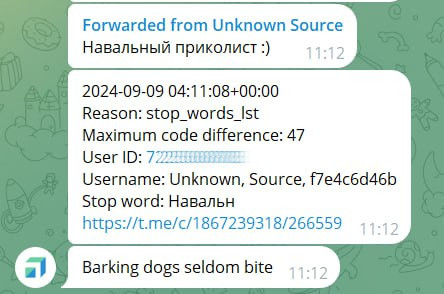

# Лабораторная работа №1. Проверка сообщения на спам

**POV:** Чат телеграм-канала должностного лица облюбовали спаммеры. Нужно читать каждое сообщение в чате и классифицировать его. Алгоритм классифицикации одного сообщения такой: пользователь-отправитель из белого "списка" - не спам. Текст сообщения содержит "плохие сиволы" или "запрещенные слова" - это спам. Обратите внимание, что запрещенные слова - это часть спам-сообщения, которое ранее отсылали злоумышленники, именно так с ошибками, со стилистикой и именно этими символами нужно искать совпадение с текстом во всех остальных сообщениях. Текст содержит "подозрительные" слова - это подозрительное сообщение. Сообщение не содержит текста или текст очень короткий, меньше 5 символов - это подозрительное сообщение.

Далее подозрительное сообщение пересылается в чат администраторов, для принятия решения. Распознавать картинки, стикеры, видео, аудио, кружочки... администраторы будут вручную. Также в чат редакции посылается сообщение с информацией о пользователе оставившем подозрительный комментарий, причина, по которой распознано подозрительное сообщение и ссылка на его комментарий для оперативного реагирования. Спам-сообщение удаляется, но само сообщение и информация о спамере также пересылается в чат администраторов. Если сообщение удалено, то дополнительно присылается фраза-индикатор.

**Задание:** Написать программу, проверяющую сообщение на спам. На вход программе подаётся две строки. Первая строка - ID автора сообщения. Вторая строка - непосредственно, само сообщение. Программа считывает строку и классифицирует её. В результате проверки программа выводит в консоль статус сообщения и причину, по которой был присвоен этот статус.

Список плохих символов, подозрительных и запрещённых слов, список белых ID приведен на следующих страницах.

1. Сообщения от аккаунтов в белом списке проверки не подлежат. *Статус OK, Причина clean*
2. Если строка короче 5 символов, то это подозрительная строка. *Статус suspicious, Причина short*
3. Если строка пустая, то это подозрительная строка. *Статус suspicious, Причина empty*
4. Если строка содержит хотя бы одну подозрительную фразу или ссылку, то это подозрительная строка. *Статус suspicious, Причина bad words*
5. Если строка содержит хотя бы одну запрещенную букву, то это спам. *Статус spam, Причина greek*
6. Если строка содержит хотя бы одну запрещенную фразу (регистр важен), то это спам. *Статус spam, Причинаspam words*
7. Если ни одно из этих условий не выполнено, то это нормальное сообщение. *Статус OK, Причина clean*




Пример отработки спама в чате. Встретилось слово из списка плохих слов. Сообщение удалено.

**Подумать:** Иногда злоумышленник заменяет в русском слове некоторые буквы на цифры или латинские буквы. Как быть в этом случае?

**Например:** м0шенник, мошеhhик

**А это не спам:** 1D, http://yandex.ru/123/

## Плохие символы

```
letters_greek_set = {
    chr(776),
    chr(782),
    chr(804),
    chr(812),
    chr(816),
    chr(826),
    chr(859),
    chr(863),
    chr(864),
    chr(8424),
    "ä",
    "ό",
    "ę",
    "ҕ",
    "Ō",
    "Ⲙ",
    "Ⲥ",
    "Ⲕ",
    "Ⲣ",
    "ᗩ",
    "ē",
    "ọ",
    "ợ",
    "Ƿ",
    "ã",
    "ϲ",
    "ҝ",
    "ꭓ",
    "ɞ",
    "ꚁ",
    "ҏ",
    "ⲃ",
    "ⲣ",
    "π",
    "δ",
    "Η",
    "κ",
    "Χ",
    "Ο",
    "Τ",
    "Α",
    "τ",
    "γ",
    "Λ",
    "Ε",
    "Ρ",
    "ק",
    "℮",
    "σ",
    "Π",
    "Μ",
    "ο",
    "Κ",
    "ᴀ",
    "è",
    "ᧉ",
    "ꚍ",
    "Β",
    "ρ",
    "ⲇ",
    "ⲙ",
    "Ꞵ",
    "ⲥ",
    "ⲏ",
    "ⲟ",
    "ⲧ",
    "ⲕ",
    "ᴏ",
    "가",
    "져",
    "가",
    "세",
    "요",
}
```

Спаммеры придумали заменять буквы кириллицы буквами греческого алфавита и другими символами unucode, похожими по написанию. Рядовой пользователь не сможет просто так написать эти буквы, наверняка это сделал злоумышленник.


## Запрещенные слова

```
spam_words = [
    "работающим родителям 40% от зарплаты", 
    "нам это помощь не останавливается", 
    "оказывает лучшую помощь семьям",
    "Получайте скорее https://",
    "https://m.dzen.ru/",
    "https://dzen.ru/",
    "успеет сможет получить деньги",
    "можно здесь http",
    "забрать надо http"
    "Жми нижe чтoбы yвидeть этoт тpeш",
    "переходите http",
    "получайте http",
    "Навальный",
    "успеете можете получить денег",
    "в шоке получайте http",
    "Получайте тоже http",
    "получайте тоже http"
]
```

Это не все слова на которые "наводится" фильтр спама. По этическим соображениям и для экономии места список изрядно сокращён. Список пополняется вручную, чтобы подстроиться под фантазии спаммеров. За полтора года собрано более 2000 запрещённых слов.


## Подозрительные слова

```python
bad_words = [
    "зеленск",
    "сма",
    "украин",
    "киев",
    "катастрoфа",
    "голос",
    "выборы",
    "рейтинг",
    "кандидатуру",
    "выдвинул",
    "позор"
]
```

Эти слова могут содержаться в спам-сообщениях и в сообщениях обычных граждан и государственных структур. На эти сообщения стоит администратору обратить внимание.

## Белый список ID

```
white_ids = [
    48438618, 
    72954094, 
    27763799, 
    96899148, 
    59392285,
    83180494, 
    23075997, 
    26779524, 
    41131670, 
    54679109
]
```
