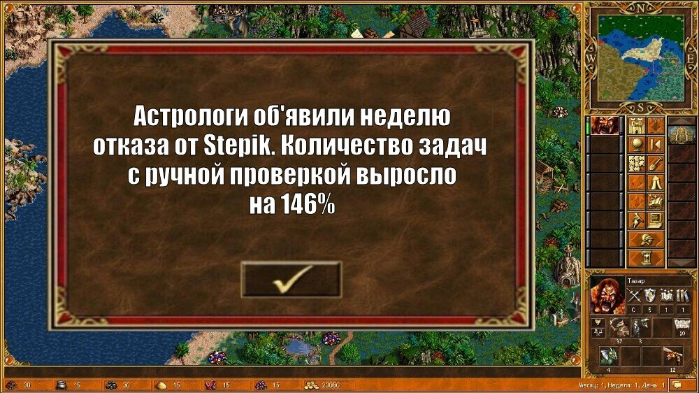

# Лабораторная работа №4 ООП

**Цель:** Закрепить понимание инкапсуляции, полиморфизма, перегрузки операторов и наследования на практике.



## Задача 1. Инкапсуляция: «Умный кошелёк»

Создайте класс `Wallet`. 
1. Конструктор `__init__(self, initial_balance)` принимает начальный баланс. Если передано отрицательное число, баланс должен стать `0`.
2. Метод `deposit(amount)` пополняет счёт. Если `amount <= 0`, метод ничего не делает и возвращает `False`, иначе возвращает `True`.
3. Метод `withdraw(amount)` снимает средства. Если `amount <= 0` или средств не хватает, возвращает `False`, иначе возвращает `True`.
4. Метод `get_balance()` возвращает текущий баланс. Численное значение

*Примечание:* Атрибут баланса должен быть защищённым (соглашение об инкапсуляции).

## Задача 2. Полиморфизм: «Склад фигур»

Реализуйте классы `Triangle` (принимает 3 стороны: a, b, c) и `Circle` (принимает радиус r). Оба класса должны иметь метод `perimeter()`.

Напишите полиморфную функцию `calculate_total_perimeter(shapes)`, которая принимает список любых фигур и возвращает сумму их периметров. Функция не должна использовать `isinstance` или `type`. Функция должна работать с любыми объектами, у которых есть метод `perimeter()`
## Задача 3. Операции с векторами в двумерном пространстве

Создайте класс `Vector2D` с атрибутами `x` и `y`.

Переопределите следующие операторы:
1. `+` (`__add__`): возвращает новый вектор, являющийся суммой двух векторов.
2. `*` (`__mul__`): если второй операнд — число, возвращает новый вектор, умноженный на это число (скалярное умножение).
3. `==` (`__eq__`): векторы равны, если равны их `x` и `y`.
4. `__str__`: возвращает строку вида `"(x, y)"` (например, `"(3, 4)"`).
5. `__hash__`: векторы должны быть хешируемыми, чтобы их можно было использовать в `set` и как ключи `dict`. Хеш должен быть согласован с `__eq__`: если `v1 == v2`, то `hash(v1) == hash(v2)`.
    
_Важно:_
- В методах `__add__` и `__mul__` используйте проверку типов и возвращайте `NotImplemented`, если тип не подходит.
- В Python при переопределении `__eq__` атрибут `__hash__` автоматически становится `None`, и объект перестаёт быть хешируемым. Поэтому `__hash__` нужно задать явно.

## Задача 4. Наследование: «Сотрудники и Менеджеры»

Есть базовый класс `Employee`:

```python
class Employee:
    def __init__(self, name, base_salary):
        self.name = name
        self.base_salary = base_salary

    def calculate_bonus(self):
        return self.base_salary * 0.10  # 10% от зарплаты
```

Создайте класс `Manager`, который **наследуется** от `Employee`.

1. Конструктор `Manager` принимает `name`, `base_salary` и `team_size` (размер команды). Используйте `super()` для инициализации базовых атрибутов.
2. Переопределите метод `calculate_bonus()`: бонус менеджера составляет 10% от базовой зарплаты **плюс** 5% от базовой зарплаты за каждого члена команды (`team_size`).

[Скачать стенд для этой работы](https://github.com/pascal65536/praxis_tmp/tree/main/praxis/lab4)

