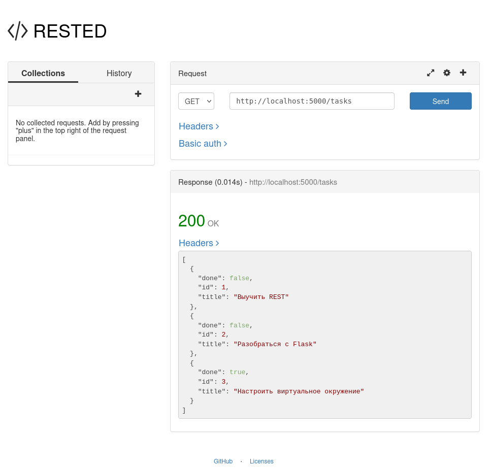
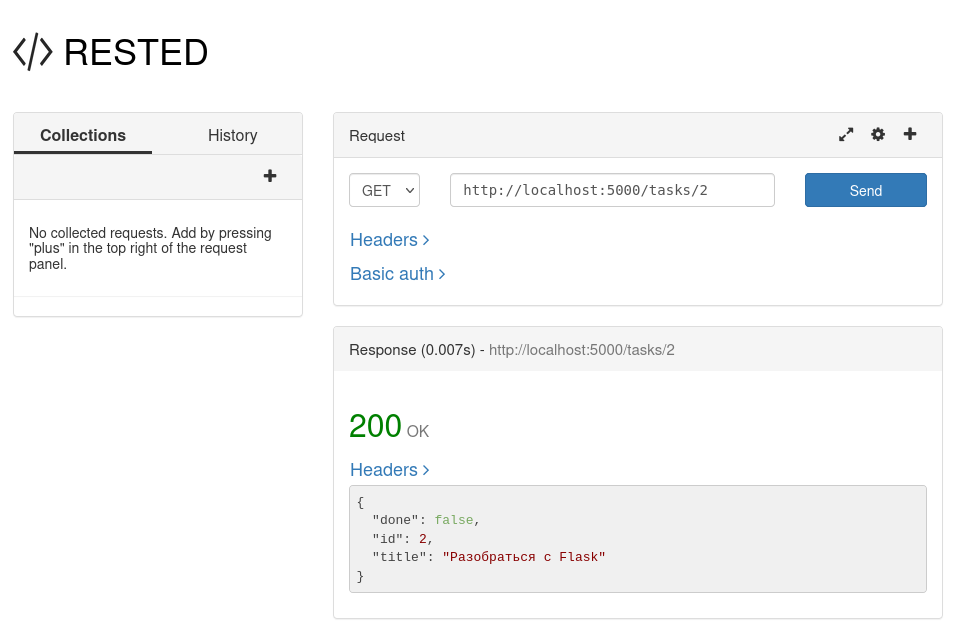
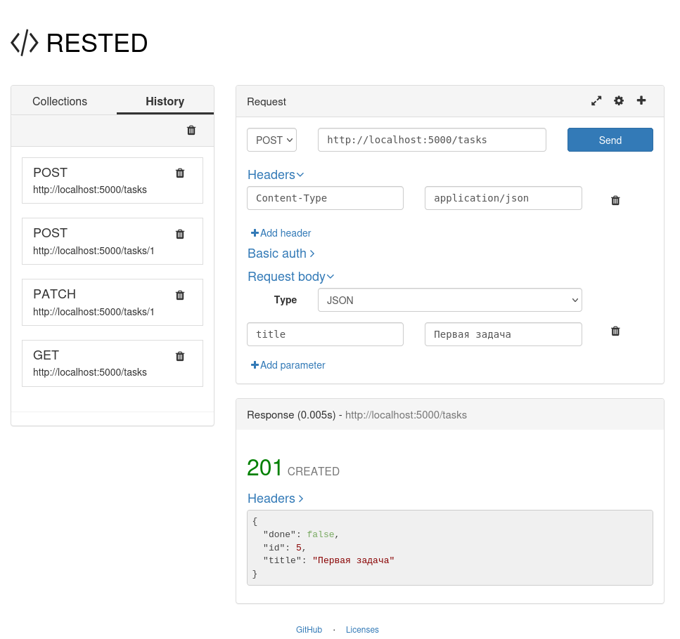
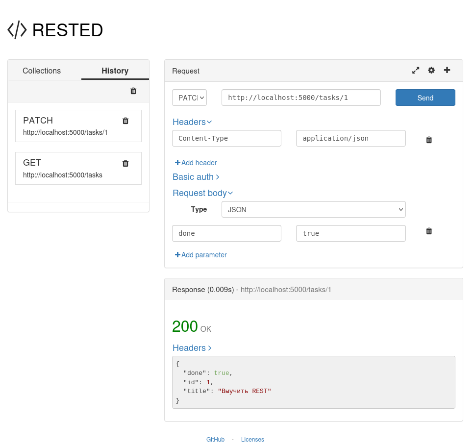
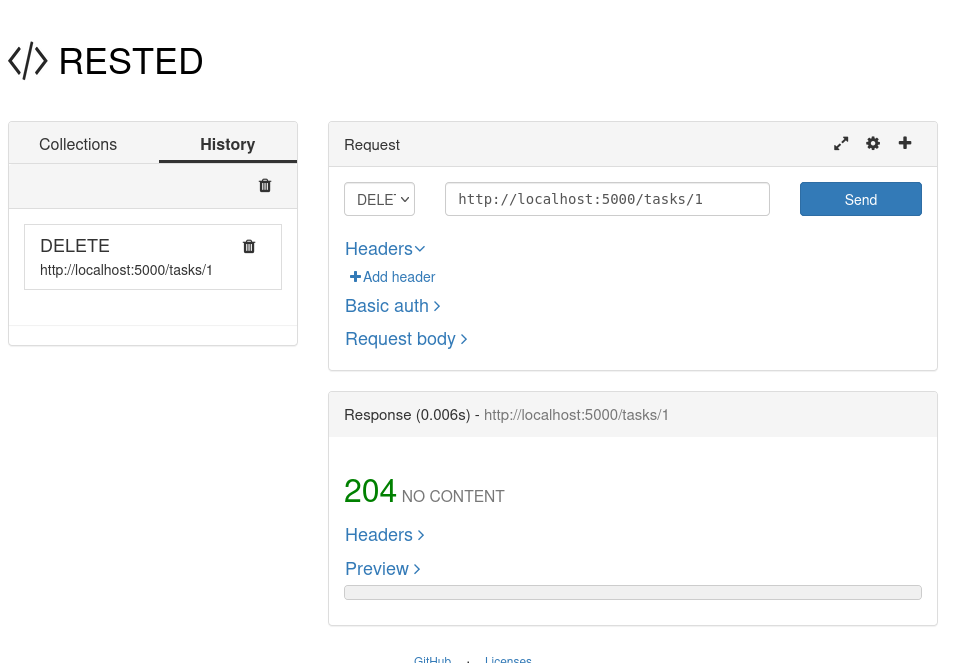
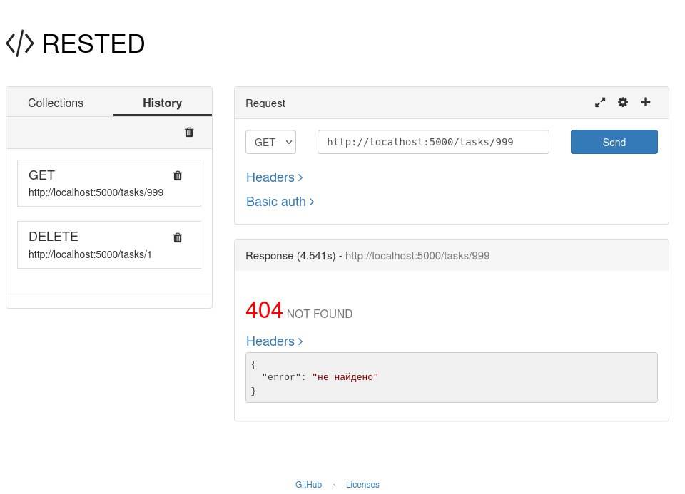

# Лабораторная работа №5. RES API

Прежде чем приступить к заданию, давайте вместе напишем, запустим и проверим **минимальный CRUD**. Цель — увидеть, как выглядит REST API «вживую».

# Создаём виртуальное окружение

Виртуальное окружение — это отдельная папка (мы назовём её `.venv`), внутри которой лежит свой собственный Python и свои пакеты. Благодаря этому:
- пакеты одного проекта не конфликтуют с пакетами другого;
- ваша система остаётся чистой — ничего не устанавливается «глобально»;
- окружение легко удалить и пересоздать, если что-то пошло не так.

**Откройте терминал**, перейдите в папку проекта:

```bash
cd путь/до/lab5
```

Теперь создаём окружение одной командой:

```bash
python3 -m venv .venv # Linux
python -m venv .venv  # Windows
```

**Что происходит?**

В текущей папке появилась скрытая папка `.venv`. Можете убедиться:

```bash
ls -a   # Linux
dir /a  # Windows
```

Вы увидите `.venv` в списке. Внутри — свой Python, свой `pip`, свои библиотеки. Пока ничего не установлено, но фундамент готов. В эту папку будут устанавливаться нужные пакеты. Содержимое этой папки только ваше. В Git передавать эту папку нельзя - она тяжелая и легко восстанавливается одной командой. Экономьте место на Git, пожалуйста.

# Активируем вирутальное окружение

**Зачем активировать?** Чтобы ваш терминал «понял»: теперь команды `python` и `pip` должны брать инструменты из `.venv`, а не из системы. Активация — это как надеть очки: терминал начинает видеть именно нашу песочницу.

Команда зависит от операционной системы и оболочки. Выберите свою:

**Linux / macOS (bash, zsh):**
```bash
source .venv/bin/activate
```

**Windows — PowerShell:**
```powershell
.venv\Scripts\Activate.ps1
```

**Windows — cmd:**
```cmd
.venv\Scripts\activate.bat
```

**Windows — Git Bash:**
```bash
source .venv/Scripts/activate
```

**Если PowerShell ругается на политику выполнения** («cannot be loaded because running scripts is disabled»), один раз выполните и подтвердите команду. После этого активация заработает.
```powershell
Set-ExecutionPolicy -Scope CurrentUser -ExecutionPolicy RemoteSigned
```

# Как понять, что всё получилось

В начале строки приглашения появится префикс **`(.venv)`**:

```cmd
(.venv) user@machine:~/lab5$
```

Это главный признак. И ещё одна проверка — какой Python теперь используется:

```bash
which python      # Linux / macOS
where python      # Windows
```

Путь должен вести внутрь `.venv` (например, `.../lab5/.venv/bin/python`). 

Когда закончите работу и захотите «выйти» из окружения — просто наберите `deactivate`. Префикс `(.venv)` исчезнет, вернётесь в системный промпт. Ничего не сломается.
# Устанавливаем Flask

Убедитесь, что префикс `(.venv)` на месте (иначе пакет уйдёт в систему — не то, что нам нужно). В linux-подобных системах это запрещено. Устанавливаем Flask:

```bash
pip install flask requests
```

Пока `pip` качает и распаковывает, вы увидите что-то вроде:

```
Collecting flask
  Downloading flask-3.x.x-py3-none-any.whl
Collecting werkzeug...
Collecting jinja2...
...
Successfully installed flask-3.x.x jinja2-... werkzeug-...
```

**Обратите внимание:** Flask тянет за собой несколько зависимостей (`werkzeug`, `jinja2`, `click`, `itsdangerous`, `markupsafe`, `blinker`). Это нормально — они нужны ему для работы. Все они установились внутрь `.venv`, а не в систему.
### Проверяем, что Flask на месте

Два быстрых способа:

```bash
pip list
```

Вы увидите список установленных пакетов и их версии.

```cmd
Package            Version
------------------ ----------
blinker            1.9.0
certifi            2026.10.18
charset-normalizer 3.5.2
click              8.5.0
Flask              3.1.3
idna               3.20
itsdangerous       2.2.0
Jinja2             3.1.6
MarkupSafe         3.0.4
pip                24.0
requests           2.34.2
urllib3            2.8.0
Werkzeug           3.1.9
```

Или в интерактивной консоли Python

```cmd
python
```

```python
import flask
print(flask.__version__)
```

Должна напечататься версия, например `3.1.3`. Если версия появилась — установка прошла успешно. 

Через некоторое время этот способ перестанет работать, по этому запоминаем новый способ, через метаданные:

```python
import importlib.metadata
print(importlib.metadata.version("flask"))
# Вывод 3.1.3
```

# requirements.txt

Чтобы проект можно было легко воспроизвести на другой машине, сохраним список пакетов в файл:

```bash
pip freeze > requirements.txt
```

Откройте `requirements.txt` — там будет примерно:

```text
blinker==1.9.0
certifi==2026.10.18
charset-normalizer==3.5.2
click==8.5.0
Flask==3.1.3
idna==3.20
itsdangerous==2.2.0
Jinja2==3.1.6
MarkupSafe==3.0.4
requests==2.34.2
urllib3==2.8.0
Werkzeug==3.1.9
```

**Зачем это:** на другой машине достаточно будет набрать `pip install -r requirements.txt` — и там установятся  те же самые версии. Это стандартная практика, и ваш `requirements.txt` — часть «чистоты» репозитория.
# .gitignore

Убедитесь, что в корне проекта есть файл `.gitignore` с содержимым. Если такого файла нет, то его следует создать. 

```
.venv/
__pycache__/
*.pyc
```

**Почему:** папка `.venv` весит десятки мегабайт, и в Git ей нечего делать. `.gitignore` говорит Git «не трогай эти файлы, не отслеживай их». Откровенно говоря комьюнити разработчиков уже собрали все возможные исключения в один файл. Его вы можете получить, когда будете создавать проект на GitHub. 
# Hello, Flask!

Создадим небольшое приложение - трекер задач. Создайте в рабочей папке файл `demo.py` и наберите (или скопируйте) следующее:

```python
from flask import Flask, request, jsonify

app = Flask(__name__)

tasks = [ 
    {"id": 1, "title": "Выучить REST", "done": False},
    {"id": 2, "title": "Разобраться с Flask", "done": False},
    {"id": 3, "title": "Настроить виртуальное окружение", "done": True},
]

next_id = max(t["id"] for t in tasks) + 1


@app.get("/tasks")                       # Read (список)
def list_tasks():
    return jsonify(tasks), 200


@app.get("/tasks/<int:task_id>")         # Read (одна)
def get_task(task_id):
    for t in tasks:
        if t["id"] == task_id:
            return jsonify(t), 200
    return jsonify({"error": "не найдено"}), 404


@app.post("/tasks")                      # Create
def create_task():
    global next_id
    data = request.get_json(silent=True) or {}
    task = {"id": next_id, "title": data.get("title", ""), "done": False}
    tasks.append(task)
    next_id += 1
    return jsonify(task), 201


@app.patch("/tasks/<int:task_id>")       # Update
def update_task(task_id):
    for t in tasks:
        if t["id"] == task_id:
            t.update(request.get_json(silent=True) or {})
            return jsonify(t), 200
    return jsonify({"error": "не найдено"}), 404


@app.delete("/tasks/<int:task_id>")      # Delete
def delete_task(task_id):
    global tasks
    tasks = [t for t in tasks if t["id"] != task_id]
    return "", 204


if __name__ == "__main__":
    app.run(debug=True)
```

**Что тут происходит:**

**`tasks` и `next_id`** — состояние хранится в памяти процесса. Это самое простое, что можно придумать. После перезагрузке все изменения пропадут и вернутся к стартовому значению.

**`@app.get("/tasks")`** — декоратор привязывает функцию к URL `/tasks` и методу `GET`. Flask сам разберётся, что на `GET /tasks` надо вызвать `list_tasks`. 

**`<int:task_id>`** в маршруте — конвертер. Flask попытается превратить сегмент URL в целое число и передаст его в функцию как аргумент `task_id`. Если сегмент не число (например, `/tasks/abc`) — Flask вернёт **404 ещё до вызова функции**, потому что маршрут не совпал. 

**`request.get_json(silent=True) or {}`** — читаем JSON из тела запроса. `silent=True` означает «не бросай исключение, если тело не JSON, верни `None`». Тогда `or {}` подставит пустой словарь, и дальше `data.get("title", "")` не упадёт. **Заметьте:** здесь мы не различаем «тело не JSON» и «тело пустое» — в обоих случаях `data` будет `{}`. 

**`return jsonify(tasks), 200`** — кортеж `(тело, код)`. Flask возьмёт первый элемент как тело, второй — как HTTP-код. То же самое с `201` после создания и `204` после удаления. **Обратите внимание:** для `204` мы возвращаем `""` — пустую строку, потому что по стандарту ответ 204 не должен иметь тела.

**`t.update(request.get_json(...) or {})`** в `PATCH` — простое «наложить присланные поля на существующие». Работает, но без валидации: если прислать `{"done": "false"}` (строку), в задаче окажется строка `"false"`, а не булево. 

**`global next_id`** — поскольку мы меняем переменную модуля из функции, нужен `global`. В `DELETE` то же самое с `tasks` (мы пересоздаём список). Если забыть `global` — Python создаст локальную переменную и счётчик `id` перестанет расти.
# Первый торжественный запуск Flask

Убедитесь, что виртуальное окружение активно (в приглашении `(.venv)`), и запустите:

```bash
python demo.py
```

**Что вы должны увидеть в консоли:**

```
 * Serving Flask app 'demo'
 * Debug mode: on
 * Running on http://127.0.0.1:5000
 * Debugger is active!
```

**Заметьте:** сервер занял текущий терминал — он не вернёт приглашение, пока вы не нажмёте `Ctrl+C`. 
# Проверяем API через RESTED

Для проверки лучше использовать `curl`,  программу на Python с ипользованием `requests` или приложение к **Mozilla Firefox RESTED**. Здесь и далее будут показаны оба способа.

В VSCode запустите:

```bash
python -m ensurepip --
python -m pip --version
```
## **Чтение полного списка**

GET

```bash
import requests

url = 'http://localhost:5000/tasks'
response = requests.get(url)
print('status_code =', response.status_code)
print('json =', response.json())
```

**Ожидаемый вывод:**
```json
status_code = 200

json = [{'done': False, 'id': 1, 'title': 'Выучить REST'}, {'done': False, 'id': 2, 'title': 'Разобраться с Flask'}, {'done': True, 'id': 3, 'title': 'Настроить виртуальное окружение'}]
```

Проверьте `http://localhost:5000/tasks` 



Тоже самое можно выполнить в [RESTED](https://addons.mozilla.org/en-US/firefox/addon/rested/)

## **Чтение конкретной записи**

GET

```python
import requests

url = 'http://localhost:5000/tasks/2'
response = requests.get(url)
print('status_code =', response.status_code)
print('json =', response.json())
```

**Ожидаемый вывод:**
```bash
status_code = 200
json = {'done': False, 'id': 2, 'title': 'Разобраться с Flask'}
```

Проверьте `http://localhost:5000/tasks` 





## **Создание**

POST

```python
import requests

url = 'http://localhost:5000/tasks'
data = {"title": "Первая задача"}
response = requests.post(url, json=data)
print('status_code =', response.status_code)
print('json =', response.json())
```

Передаём requests методом POST. Полезную нагрузку передаём отдельно в json параметре.

**Ожидаемый вывод:**
```
status_code = 201
json = {'done': False, 'id': 4, 'title': 'Первая задача'}
```
Код 201 говорит о том, что создан новый объект. В теле ответа прилетел новый ID, которого ранее не было на сервере. done=False - это значение по умолчанию, хотя мы его не присылали.

Проверьте `http://localhost:5000/tasks` 




**Заметьте:** заголовок `Content-Type: application/json` в запросе обязателен. Без него `request.get_json()` не распознает тело как JSON. Если забыть — `data` окажется `{}`, и создастся задача с пустым `title`. Попробуйте ради интереса — увидите, как легко получить неожиданный результат. В коде на Python мы не указали заголовок явно. Сделаем это в следующий раз.

## **Частичное обновление**

PATCH

```python
import requests

url = 'http://localhost:5000/tasks/1'
data = {"done": True}

# response = requests.patch(url, json=data)

headers = {"Content-Type": "application/json"}
response = requests.patch(url, json=data, headers=headers)

print('status_code =', response.status_code)
print('json =', response.json())
print('headers =', response.request.headers)
```

Здесь показаны 2 варианта - с явным заголовком и без.

**Ожидаемый вывод:**
```bash
status_code = 200
json = {'done': True, 'id': 1, 'title': 'Выучить REST'}
headers = {'User-Agent': 'python-requests/2.34.2', 'Accept-Encoding': 'gzip, deflate', 'Accept': '*/*', 'Connection': 'keep-alive', 'Content-Type': 'application/json', 'Content-Length': '14'}
```

**Обратите внимание:** мы прислали только `done`, а `title` и `id` сохранились — это и есть «частичное обновление» (`PATCH`), в отличие от `PUT`, который заменил бы ресурс целиком.
В заголовке headers найдите ключ `Content-Type` - это наш ключ, который мы указали вручную.

**`Content-Type`**  
Указывает серверу, в каком формате вы прислали тело запроса. Для JSON это `application/json`. Без него Flask (через `request.get_json()`) не поймёт, что вы прислали JSON, и данные не прочитаются. Именно поэтому при работе с `requests` удобно использовать параметр `json=`, который ставит этот заголовок автоматически.

**`Accept`**  
Сообщает серверу, в каком формате вы хотите получить ответ. Часто используется `application/json`, чтобы явно попросить JSON. Это необязательный заголовок, но полезный для ясности .

**`Authorization`**  
Передаёт учётные данные для аутентификации (например, токен). В вашем текущем API аутентификации нет, но в реальных проектах это один из ключевых заголовков. В `requests` для этого есть отдельный параметр `auth=` .

**Другие распространённые заголовки запроса**

- **`User-Agent`**: Сообщает серверу, какая программа и версия делают запрос (например, `python-requests/2.31.0`). Сервер может использовать это для статистики или адаптации ответа.
    
- **`Accept-Language`**: Указывает предпочтительный язык ответа (например, `ru-RU`). Сервер может вернуть контент на этом языке, если умеет.
    
- **`Accept-Encoding`**: Сообщает, какие алгоритмы сжатия (например, `gzip`) понимает клиент. Это позволяет экономить трафик.
    
- **`Cookie`**: Передаёт сохранённые куки, которые ранее установил сервер. Используется для сессий и персонализации.
    
- **`Referer`**: Содержит адрес страницы, с которой был сделан запрос. Иногда используется для аналитики или проверок безопасности.




## **Удаление**

DELETE

```python
import requests

url = 'http://localhost:5000/tasks/4'
response = requests.delete(url)
print('status_code =', response.status_code)
print('text =', repr(response.text))
# тело ответа (должно быть пустым)
print('content =', repr(response.content))
# то же в байтах
```

**Ожидаемый вывод:**
```cmd
status_code = 204
text = ''
content = b''
```

**На что обратить внимание:**
- код `204 NO CONTENT` — успех, тело отсутствует;
- после заголовков — **пустая строка**, никакого JSON. Это правильно: 204 по стандарту не несёт тела;

Проверьте `http://localhost:5000/tasks` 





## **Проверяем 404**

```python
import requests

url = 'http://localhost:5000/tasks/999'
response = requests.get(url)
print('status_code =', response.status_code)
print('json =', response.json())
```

**Ожидаемый вывод:**
```text
status_code = 404
json = {'error': 'не найдено'}
```

**Обратите внимание:** 404 вернул **наш код** (функция `get_task` не нашла задачу), а не Flask — тело `{"error": "не найдено"}` наше. Сравните с `curl -i http://localhost:5000/tasks/abc` — там тоже 404, но с HTML-страницей Flask, потому что маршрут не совпал и до нашей функции дело не дошло. **Запомните эту разницу:** 404 «ресурс не найден» и 404 «такого маршрута нет» — разные вещи, хотя код одинаковый.




## Теоретические сведения

### REST

REST (Representational State Transfer) — архитектурный стиль взаимодействия клиента и сервера через HTTP, сформулированный Роем Филдингом в 2000 году. Ядро подхода: **ресурсы**, адресуемые через URI, над которыми выполняются стандартные операции HTTP. Сервис, следующий этим принципам, называют RESTful.

Всё, чему можно дать имя, — ресурс. Коллекция задач адресуется `/tasks`, конкретная задача — `/tasks/1`. Проектирование API — ответ на два вопроса: какие ресурсы открываем и какими «глаголами» HTTP над ними оперируем.

### HTTP-методы и CRUD

- **GET** — чтение ресурса или коллекции (идемпотентен)
- **POST** — создание нового ресурса (не идемпотентен: повтор создаст дубль)
- **PUT** — полная замена ресурса (идемпотентен)
- **PATCH** — частичное обновление, только переданные поля
- **DELETE** — удаление ресурса (идемпотентен: повторный удалённого → 404)

Идемпотентность — повторный одинаковый запрос даёт тот же результат, что и первый. Это ответ на ненадёжность сетей: при обрыве соединения клиент вправе безопасно повторить GET, PUT или DELETE.

### Коды статусов

- **200 OK** — успешное чтение или обновление
- **201 Created** — ресурс создан (успешный POST)
- **204 No Content** — успех без тела (успешный DELETE)
- **400 Bad Request** — запрос синтаксически некорректен: невалидный JSON, нет обязательного поля, невалидные параметры
- **404 Not Found** — ресурса нет; несовпадение типа `<int:id>` даёт 404 ещё до обработчика
- **409 Conflict** — конфликт состояния: дубликат уникального поля
- **422 Unprocessable Entity** — синтаксис верен, семантика неверна: пустое название, превышение лимита длины

### Форматы ответа

Одиночная задача — объект:

```json
{"id": 6, "title": "Выучить REST", "done": false, "created_at": "2026-10-18T23:00:00"}
```

Список — обёртка с мета-информацией для пейджинации:

```json
{"items": [...], "total": 5, "page": 1, "per_page": 10, "pages": 1}
```

Ошибка — единый формат: `{"error": "описание"}`.

## Постановка задачи

Требуется реализовать сервер задач (ToDo) — REST API на Flask без использования blueprints, в одном файле `app.py`. Хранение — в памяти. Сервер стартует на `http://localhost:5000`.

### Модель данных

Задача — объект с полями: `id` (int, выдаёт сервер), `title` (string), `done` (bool, по умолчанию `false`), `created_at` (string, дата создания в ISO 8601).

### Эндпоинты

**GET /tasks** — список задач в обёртке `{items, total, page, per_page, pages}`. Параметры:

- `done=true|false` — фильтр по статусу
- `q=строка` — поиск по подстроке в названии (регистронезависимо)
- `sort=id|title|created_at` — поле сортировки
- `order=asc|desc` — направление (по умолчанию `asc`)
- `page=N` — номер страницы, начиная с 1
- `per_page=N` — размер страницы, по умолчанию 10, максимум 100

Невалидные значения параметров => 400. Запрос страницы за пределами диапазона — не ошибка: код 200 и пустой `items`.

**GET /tasks/<int:id>** — одна задача. Несуществующий id => 404.

**POST /tasks** — создание. Тело: `title` (обязателен), `done` (необязателен). Успех => 201 и созданный объект.

**PUT /tasks/<int:id>** — полная замена: `title` и `done`; недостающие поля принимают значения по умолчанию.

**PATCH /tasks/<int:id>** — частичное обновление: меняются только переданные поля.

**DELETE /tasks/<int:id>** — удаление. Успех => 204 с пустым телом. Повторный DELETE => 404.

**GET /** — служебный: JSON с описанием сервиса и списком эндпоинтов (способ убедиться, что сервер жив).

###  Правила контроля

- `title` обязателен, непустой, не длиннее 200 символов
- дубликаты названий запрещены без учёта регистра и повторных пробелов → 409; переименование задачи в её собственное название допустимо
- `id` монотонны и не переиспользуются после удаления

###  Начальные данные

При старте сервер заполняет хранилище пятью демонстрационными задачами: «Купить молоко» (done), «Выучить REST», «Сдать лабораторную» (done), «Проверить почту», «Позвонить маме» — с нарастающими `created_at`. Счётчик `id` продолжается после них.

## Этапы выполнения

### Этап 1. Окружение

В рабочей папке у вас уже есть `demo.py`  Создайте в той же папке окружение, установите зависимости и скопируйте сюда шаблон `app.py`:

```bash
mkdir lab5 && cd lab5
python3 -m venv .venv
source .venv/bin/activate        # Windows: .venv\Scripts\Activate.ps1
pip install flask requests
pip freeze > requirements.txt
```

Создайте `.gitignore` (пригодится на этапе публикации):

```
.venv/
__pycache__/
*.pyc
```

Контрольная точка: в приглашении терминала `(.venv)`, `pip list` содержит flask и requests, `requirements.txt` непустой.

### Этап 2. Запуск

```bash
python app.py
```

Сервер поднимается на порту 5000. Откройте в браузере `http://localhost:5000/` — должно вернуться JSON-описание API. Сервер хранит состояние в памяти: перед каждым полным прогоном тестов перезапускайте его.

### Этап 3. Программные тесты

Файл `test_tasks.py` проверяет все требования постановки: seed, пейджинация, сортировка, фильтры, коды ошибок, идемпотентность DELETE, монотонность id. Тесты написаны на `requests` + `assert` — каждая проверка читается как обычный код:

```bash
python test_tasks.py
```

Ожидается последовательность «N. ... ок» и строка «Все тесты пройдены». При провале `assert` Python покажет файл и строку с ожидаемым и фактическим значением — доведите сервер до зелёного прогона. Тесты самовосстанавливают состояние сервера (блок `finally`), повторять можно без перезапуска.

### Этап 4. Ручные тесты через Rested

Установите расширение Rested для Mozilla Firefox (addons.mozilla.org => «Rested» => «Добавить в Firefox») — REST-клиент прямо в браузере: все HTTP-методы, заголовки, коллекции запросов с сохранением в локальное хранилище, URL-шаблоны вида `http://localhost:5000/tasks/{{taskId}}` с общей панелью переменных, импорт коллекций Postman и HAR.

Создайте коллекцию «Tasks API» и пройдите минимум 15 запросов, сверяя коды с постановкой задачи:

1. `GET /` — 200
2. `GET /tasks` — 200
3. `GET /tasks?page=1&per_page=2` — 200, в ответе `pages=3`
4. `GET /tasks?sort=title&order=asc` — 200
5. `GET /tasks?q=молоко` — 200, один результат
6. `POST /tasks` с `{"title": "Rested-проверка"}` — 201, запомните `id`
7. повторный `POST` с тем же title — 409
8. `POST` с пустым title — 422
9. `GET /tasks/{{taskId}}` (taskId = id из п. 6) — 200
10. `PATCH /tasks/{{taskId}}` с `{"done": true}` — 200
11. `GET /tasks/999999` — 404
12. `PUT /tasks/{{taskId}}` — 200
13. `DELETE /tasks/{{taskId}}` — 204
14. повторный `DELETE` — 404
15. `GET /tasks/abc` — 404

Сохраните коллекцию. По желанию: экспорт/импорт через Postman-формат, заголовок `Accept`, basic auth.

### Этап 5. Публикация на GitHub

1. Установите GitHub Desktop (desktop.github.com) и выполните вход.
2. File => Add Local Repository → папка проекта (Desktop предложит создать репозиторий — согласитесь).
3. Убедитесь, что вкладка Changes не показывает файлы `.venv/` и `__pycache__/` (правило в `.gitignore`).
4. Commit to main с осмысленным сообщением → Publish repository / Push origin.
5. Откройте репозиторий в браузере и проверьте содержимое.

### Этап 6. Доступ контрибьютору

Settings => Collaborators => Add people => GitHub-username преподавателя => роль Write => Add. Коллега принимает приглашение. Роли Write достаточно: чтение кода и истории коммитов.

### Этап 7. Чистота репозитория

```bash
git status --porcelain                     # не выводит ничего
git check-ignore -v .venv/ __pycache__/    # правило .gitignore сработало
```

На GitHub в корне должны быть только: `app.py`, `test_tasks.py`, `requirements.txt`, `.gitignore`. Никаких `.venv/`, `__pycache__/`, `.pyc`, файлов IDE, секретов. Если мусор попал в историю: `git rm -r --cached <путь>`, коммит, push.


# Техническое задание на разработку `getmilk.py`

## 1. Общее описание

Разработать REST API для управления задачами (to-do) на Python с использованием фреймворка Flask. Приложение хранит задачи в памяти процесса, поддерживает полный набор CRUD-операций, фильтрацию, поиск, сортировку, пагинацию и контроль дубликатов.

**Стек:** Python 3.9+, Flask 3.x.
**Формат данных:** JSON (`application/json`).
**Хранение:** в памяти (список Python), без базы данных.
**Аутентификация:** отсутствует.
## 2. Модель данных

Задача (`task`) — JSON-объект со следующими полями:

- `id` — integer, генерируется автоматически, уникальный, монотонно возрастает начиная с 1;
- `title` — string, обязательный, непустой, не длиннее 200 символов, уникальный без учёта регистра и лишних пробелов;
- `done` — boolean, необязательный при создании, по умолчанию `false`;
- `created_at` — string в формате ISO 8601 (UTC), генерируется автоматически, например `2026-10-19T10:18:26.123456+00:00`.

**Нормализация `title` для сравнения:** схлопнуть все пробельные последовательности в один пробел и привести к нижнему регистру.
## 3. Начальные данные (seed)

При старте приложения хранилище заполняется пятью демонстрационными задачами:

- `Купить молоко` — `done: true`, создана 5 часов назад;
- `Выучить REST` — `done: false`, создана 4 часа назад;
- `Сдать лабораторную` — `done: true`, создана 3 часа назад;
- `Проверить почту` — `done: false`, создана 2 часа назад;
- `Позвонить маме` — `done: false`, создана 1 час назад.

Идентификаторы — от 1 до 5. После заполнения `next_id` = 6.
## 4. Эндпоинты

### 4.1. `GET /` — описание сервиса

Возвращает `200` и JSON-объект с полями `service` (строка `"tasks-api"`), `seed` (текущее количество задач, чтобы быстро убедиться, что сервер жив и данные на месте) и `endpoints` (массив строк с кратким описанием маршрутов).
### 4.2. `GET /tasks` — список с фильтрами, сортировкой, пагинацией

Поддерживает query-параметры:

- `done` — `true` или `false`, фильтр по статусу; любое другое значение → `400`;
- `q` — строка поиска, ищется подстрока в `title` регистронезависимо с нормализацией;
- `sort` — одно из `id`, `title`, `created_at`, по умолчанию `created_at`; иное значение → `400`;
- `order` — `asc` или `desc`, по умолчанию `asc`; иное значение → `400`;
- `page` — целое ≥ 1, по умолчанию `1`; меньше 1 или не целое → `400`;
- `per_page` — целое от 1 до 100, по умолчанию `10`; вне диапазона или не целое → `400`.

Ответ `200` — JSON-объект с полями `items` (массив задач текущей страницы), `page`, `per_page`, `total` (всего задач после фильтрации), `pages` (количество страниц, минимум 1).
### 4.3. `GET /tasks/<id>` — одна задача

Возвращает `200` и объект задачи. Если задачи нет — `404` с телом `{"error": "задача не найдена"}`. Если `<id>` не целое — Flask вернёт `404` до обработчика (поведение конвертера `<int:>`, реализовывать не нужно).
### 4.4. `POST /tasks` — создание

Тело запроса — JSON-объект с полями `title` (обязательно) и `done` (необязательно). Если тело не JSON-объект (невалидный JSON, массив, число, `null`) — `400`.

Валидация `title`:
- поле отсутствует → `400`;
- не строка или пустая после `strip()` → `422`;
- длина после `strip()` больше 200 → `422`;
- совпадает с существующим `title` (с нормализацией) → `409`.

Ответ `201` — созданная задача.
### 4.5. `PUT /tasks/<id>` — полная замена

Поведение как у `POST`, но: если задачи нет — `404`; `title` проверяется с исключением собственного id (своё прежнее название дубликатом не считается); при отсутствии `done` в теле он сбрасывается в `false` (полная замена). Ответ `200` — обновлённая задача.
### 4.6. `PATCH /tasks/<id>` — частичное обновление

Обновляются только переданные поля. Для `title`: валидация как в `POST`, но с исключением собственного id; если новое название после нормализации совпадает с текущим — проверка на дубликат не выполняется. Для `done`: приводится к `bool`. Ответ `200` — обновлённая задача. Ошибки: `404` — нет задачи; `400` — тело не JSON-объект; `422` — невалидный `title`; `409` — дубликат.
### 4.7. `DELETE /tasks/<id>` — удаление

Ответ `204` с пустым телом. Если задачи нет (в том числе при повторном DELETE) — `404`. Идемпотентность реализуется через `404`, а не через повторный `204`.
## 5. Общие требования

### 5.1. Формат ошибок

Все ошибки — JSON-объект вида `{"error": "текст сообщения на русском"}`.
### 5.2. Коды состояния

- `200` — успешное чтение или обновление;
- `201` — создание;
- `204` — удаление (тело пустое);
- `400` — некорректный запрос (тело не JSON-объект, невалидный query-параметр);
- `404` — ресурс не найден;
- `409` — конфликт (дубликат `title`);
- `422` — семантически невалидные данные (`title` пустой или слишком длинный).
### 5.3. Вспомогательные функции

- `now_iso()` — текущее время в ISO 8601 UTC;
- `normalize(title)` — нормализация для сравнения (пробелы + регистр);
- `err(message, code)` — формирование JSON-ответа об ошибке;
- `find_task(task_id)` — поиск задачи по id или `None`;
- `title_exists(title, exclude_id=None)` — проверка дубликата;
- `validate_title(data, exclude_id=None)` — общая валидация `title`; возвращает `(title, None)` или `(None, error_response)`;
- `seed()` — заполнение начальными данными при старте.
### 5.4. Константы

`MAX_TITLE_LEN = 200`, `DEFAULT_PER_PAGE = 10`, `MAX_PER_PAGE = 100`.
## 6. Шаблон

Ниже — скелет `app.py` со всеми маршрутами, но с пустыми телами функций и `TODO`-комментариями. Заполните их по ТЗ выше.

```python
"""Tasks API — CRUD задач на Flask.

Реализуйте функции по техническому заданию.
Все маршруты уже объявлены, тела функций пусты.
"""

from flask import Flask, request, jsonify
from datetime import datetime, timezone, timedelta

app = Flask(__name__)

tasks = []
next_id = 1

MAX_TITLE_LEN = 200
DEFAULT_PER_PAGE = 10
MAX_PER_PAGE = 100


# ---------------------------------------------------------------------------
# Вспомогательные функции
# ---------------------------------------------------------------------------

def now_iso():
    """Текущее время в ISO 8601 UTC."""
    # TODO: вернуть datetime.now(timezone.utc).isoformat()
    raise NotImplementedError


def normalize(title):
    """Нормализация title для сравнения: схлопнуть пробелы + нижний регистр."""
    # TODO: " ".join(title.split()).lower()
    raise NotImplementedError


def err(message, code):
    """JSON-ответ об ошибке: {"error": message} с заданным кодом."""
    # TODO: return jsonify({"error": message}), code
    raise NotImplementedError


def find_task(task_id):
    """Найти задачу по id или вернуть None."""
    # TODO: линейный поиск по tasks
    raise NotImplementedError


def title_exists(title, exclude_id=None):
    """Есть ли уже задача с таким title (с нормализацией)?

    exclude_id — id задачи, которую переименовываем (её собственное название
    дубликатом не считается).
    """
    # TODO: any(...) по tasks с учётом exclude_id и normalize
    raise NotImplementedError


def validate_title(data, exclude_id=None):
    """Валидация title. Возвращает (title, None) или (None, error_response).

    Правила:
      - отсутствует           -> 400
      - не строка / пустая    -> 422
      - длиннее MAX_TITLE_LEN -> 422
      - дубликат              -> 409
    """
    # TODO: реализовать по шагам, каждый шаг — return None, err(...)
    raise NotImplementedError


def seed():
    """Заполнить хранилище демонстрационными задачами при старте."""
    # TODO: 5 задач с id 1..5, created_at = now - 5ч + i часов, next_id = 6
    raise NotImplementedError


# Вызов seed() при импорте модуля
# seed()


# ---------------------------------------------------------------------------
# Вьюхи
# ---------------------------------------------------------------------------

@app.get("/tasks")
def list_tasks():
    """GET /tasks — список с фильтрами, сортировкой и пагинацией.

    Query: done, q, sort, order, page, per_page.
    Ответ: {items, page, per_page, total, pages}.
    """
    # TODO: реализовать по ТЗ п. 4.2
    raise NotImplementedError


@app.get("/tasks/<int:task_id>")
def get_task(task_id):
    """GET /tasks/<id> — одна задача. 404, если нет."""
    # TODO: find_task -> 404 или jsonify(task), 200
    raise NotImplementedError


@app.post("/tasks")
def create_task():
    """POST /tasks — создать задачу.

    Тело — JSON-объект {title, done?}.
    Валидация title через validate_title().
    Ответ 201 с созданной задачей.
    """
    # TODO: реализовать по ТЗ п. 4.4
    raise NotImplementedError


@app.put("/tasks/<int:task_id>")
def replace_task(task_id):
    """PUT /tasks/<id> — полная замена ресурса.

    Как POST, но: 404 если нет задачи; validate_title(..., exclude_id=task_id);
    отсутствующий done -> False.
    """
    # TODO: реализовать по ТЗ п. 4.5
    raise NotImplementedError


@app.patch("/tasks/<int:task_id>")
def update_task(task_id):
    """PATCH /tasks/<id> — частичное обновление.

    Обновляются только переданные поля (title и/или done).
    """
    # TODO: реализовать по ТЗ п. 4.6
    raise NotImplementedError


@app.delete("/tasks/<int:task_id>")
def delete_task(task_id):
    """DELETE /tasks/<id> — удалить задачу. 204 или 404."""
    # TODO: реализовать по ТЗ п. 4.7
    raise NotImplementedError


@app.get("/")
def index():
    """GET / — описание сервиса."""
    # TODO: {"service": "tasks-api", "seed": len(tasks), "endpoints": [...]}
    raise NotImplementedError


if __name__ == "__main__":
    app.run(debug=True)
```
## 7. Критерии готовности

Все эндпоинты возвращают коды и тела, описанные в разделе 4. Поле `title` валидируется одинаково в `POST`, `PUT`, `PATCH` (через общую `validate_title` или эквивалентную логику). Дубликаты `title` дают `409` с учётом нормализации; при `PUT` и `PATCH` собственное название дубликатом не считается. `GET /tasks` поддерживает все шесть query-параметров и возвращает объект `{items, page, per_page, total, pages}`. `DELETE` возвращает `204` с пустым телом, повторный — `404`. `GET /` возвращает `service`, `seed`, `endpoints`. При старте в хранилище 5 задач, `next_id = 6`.

[Скачать стенд для этой работы](https://github.com/pascal65536/praxis_tmp/tree/main/praxis/lab5)
