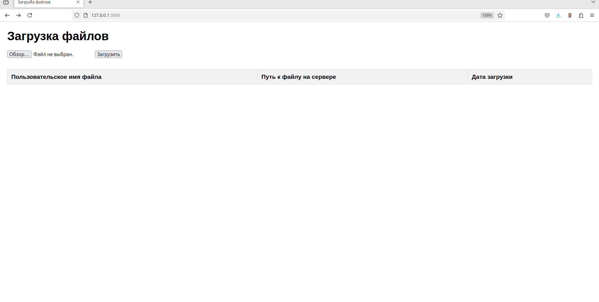

# Лабораторная работа №6. Flask приложение для загрузки файлов

Разработать Flask приложение, позволяющее пользователю загружать файлы на сервер с определенными ограничениями и отображать информацию о загруженных файлах.

## Функциональные требования:

- Приложение должно принимать файлы от пользователя через форму загрузки.
- Имя загруженного файла должно генерироваться случайным UUID и сохраняться на сервере в соответствующей директории. Реальное имя файла не должно потеряться - его нужно использовать при выводе списка загруженных файлов.

>  Например: `/upload/99/6d/996d8d977a8e1a808bc26db9207615ef.jpg`

- Приложение должно проверять тип загружаемого файла и не допускать загрузку файлов с запрещенными расширениями (например: `.exe`, `.sh`, `.php`, `.js`).
- Приложение должно проверять наличие файла с таким же MD5-хэш и не допускать загрузку дубликатов.
- Приложение должно выводить flash сообщения о результате загрузки (успех/ошибка, причина ошибки).

## Вывод информации о файлах:

После успешной загрузки файла, приложение должно отображать список всех загруженных файлов с информацией: имя файла (UUID), дата загрузки, путь к файлу на сервере, расширение файла.

## Примечание:

Для проверки типа файла можно использовать библиотеку `mimetypes`. Для генерации UUID использовать модуль `uuid`. Для определения дубликатов использовать MD5-хэш. Для хранения данных о файлах используйте JSON.

**NB!** При перезапуске приложения, информация о загруженных файлах должна сохраняться. Дубликаты не должны загружаться, даже после перезапуска.

[Скачать стенд для этой работы](https://github.com/pascal65536/praxis_tmp/tree/main/praxis/lab6)
