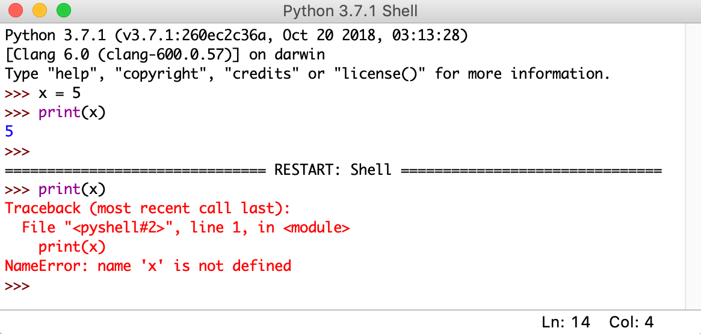
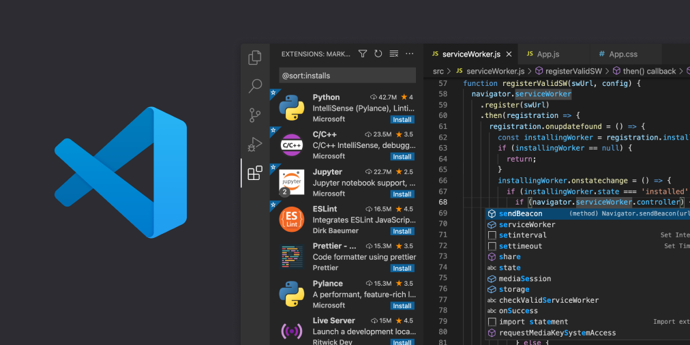
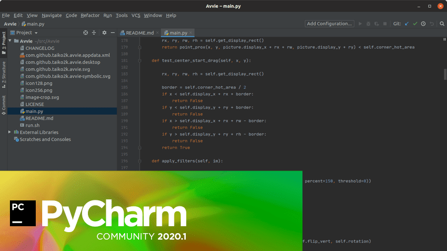

Если у вас на компьютере установлен язык программирования (компилятор или интерпретатор), можно писать код даже в Блокноте, а затем исполнять его через консоль. Но это неудобно. Разработчики пользуются редакторами кода или IDE — интегрированными средами разработки. Так называется комплекс программных средств для кодинга: в них можно писать, редактировать, исполнять и отлаживать код.

Мы поговорим о таких средствах для Python. Это популярный язык программирования, который применяется во множестве отраслей: от веба до прикладной математики. Поэтому инструменты многочисленны и разнообразны.

## IDE и редактор кода для Python: в чем разница

Итак, существует два вида ПО для кодинга: IDE и редактор кода. Они похожи с первого взгляда, но сильно различаются возможностями.

**Редактор кода** — это простая легковесная программа, которая похожа на текстовый редактор, только лучше адаптированная под написание кода. Она сохраняет файлы с нужным расширением, подсвечивает синтаксис и автоматически проверяет отступы в коде.

**IDE** — более масштабный инструмент, программный комплекс. Помимо редактора в нем есть собственная консоль, инструменты для запуска, тестирования и отладки кода. Через IDE можно создавать крупные проекты, подключать систему контроля версий (Git). Некоторые IDE позволяют устанавливать внутри себя новые фреймворки и библиотеки, не заходя в терминал системы.

## Чем редактор кода и IDE отличается от текстового редактора

Редактор кода — это или самостоятельная программа, или часть IDE. Он выглядит как окно, где можно набрать текст, но более адаптирован под код.

**Подсветка синтаксиса.** Это означает, что, например, служебные слова будут одного цвета, комментарии — другого, классы будут выделяться другим начертанием и так далее. Это помогает быстрее ориентироваться в коде и находить нужные места. Более того, большинство существующих инструментов используются для нескольких языков программирования, поэтому знают синтаксис не только Python. При создании файла можно выбрать, на какой язык будет ориентироваться подсветка. Также программа может понять это самостоятельно по расширению файла.

**Форматирование и установка отступов.** Отступы используются практически во всех языках программирования, но в Python они обязательны и являются частью синтаксиса. Редакторы обычно умеют поддерживать и ставить нужные отступы автоматически. Но это только малая часть. Хорошие IDE и редакторы поддерживают более масштабное автоформатирование. например, во многих редакторах есть спеллчекеры — они показывают, если что-то написано неправильно, и обращают внимание пользователя на ошибку. Также есть инструменты, которые автоматически дополняют команды и функции из кода.

**Возможность запуска кода.** Изначально запуск кода был прерогативой IDE, но в некоторых редакторах есть возможность запуска написанного кода в консоли непосредственно из него. Не нужно выходить из редактора и открывать терминал, все запустится автоматически нажатием соответствующей кнопки в редакторе.

**Создание, редактирование и сохранение файлов.** Большинство редакторов и практически все IDE могут показывать структуру файлов в папке. Обычно это нужно для проектов, которые включают больше одного файла. Прямо внутри среды можно переключаться между файлами, создавать новые в папках и подпапках, сохранять изменения. Более того, многие приложения поддерживают системы контроля версий вроде Git и дают возможность делать коммиты прямо из среды, причем это умеют не только IDE, но и некоторые редакторы.

**Отладка.** Это процесс нахождения и исправления ошибок. Чтобы это можно было сделать быстрее, существуют расширенные возможности: пошаговое выполнение кода, остановка исполнения в определенной точке, просмотр содержимого переменных в любой момент времени и многое другое. Все это входит в функционал инструментов отладки.

**Кастомизация.** Любую IDE и почти любой редактор можно настроить под себя. Это не только цветовая гамма и размеры шрифта, но и расположение окон и кода, панели под рукой, горячие клавиши и многое другое. Некоторые инструменты поддерживают дополнения — сторонние расширения, дополняющие функциональность. Их можно установить в IDE или даже в редактор. Например, браузерные расширения или возможность по-новому редактировать код или дополнять слова.

## Что содержится в IDE

В редакторах есть все инструменты для начального уровня работы с кодом, и часто их бывает достаточно. Рассмотрим отдельные возможности, которые предоставляют IDE:

- визуальный редактор для быстрого создания проектов из блоков и отдельных файлов;
- полная синхронизация с системой контроля версий;
- интерактивная консоль;
- дополнительные инструменты для того или иного направления IT;
- множество возможностей для наглядной отладки, тестирования, анализа кода, а также решения различных задач;
- возможность установить фреймворк или библиотеку через интерфейс среды;
- возможность работать с несколькими языками программирования, в том числе одновременно.

Кому-то будет удобнее работать с простым и не занимающим много памяти редактором, а кому-то — с масштабной IDE со множеством дополнительных возможностей.

## Популярные IDE для Python

### **IDLE**

Эта среда по умолчанию поставляется с Python. Она написана на нем, имеет все возможности интегрированной среды разработки, проста и минималистична. С ней можно начать программировать, но для дальнейшей работы, скорее всего, будет удобнее другой, более масштабный инструмент.

_Интересный факт: как язык Python был назван в честь комик-группы «Монти Пайтон», так и IDLE назвали в честь одного из участников этой группы — Эрика Айдла._

### **Visual Studio Code**

Мощная мультиязычная среда от Microsoft. Она гибко настраивается под задачи, включает инструменты для написания кода под множество платформ и направлений. Ей пользуются для веба, для написания приложений под ПК и мобильные устройства, для создания программ под разные операционные системы. Для него существует множество плагинов, написанных разными разработчиками, он полностью бесплатный. Visual Studio Code можно настроить под любой язык — нужно скачать расширения, доступные в маркетплейсе внутри самого редактора.

### **PyCharm**

Отличный вариант как для начинающих, так и для продвинутых программистов. У PyCharm понятный интерфейс, она изначально адаптирована под Python. Ее не придется долго донастраивать, чтобы код просто запустился, — можно установить IDE и сразу начать работать. Среда отлично поддерживает всевозможные дополнения и дает огромный простор действий. Но загружается и работает она все же медленнее, чем средний редактор.

PyCharm существует в платной коммерческой и бесплатной комьюнити-версии. Бесплатной хватает большинству начинающих программистов, а коммерческая нужна в основном компаниям и профессионалам, работающим с большими проектами.

### **Spyder**

Это бесплатная опенсорсная IDE для Python с важным нюансом: она рассчитана на разработку в сфере Data Science. В ней есть много инструментов и оптимизаций для работы с данными, но для других задач она подходит не так хорошо. Например, Spyder «из коробки» включает пакетный менеджер Anaconda, который используется в анализе данных и машинном обучении. Он хорошо и быстро работает с библиотеками для математики и ML. Кроме того, за него не надо платить, а основные функции IDE в нем есть.

Минус в том, что это специализированный инструмент — разработчикам вне науки о данных и машинного обучения он может показаться недостаточно удобным.

### **Thonny**

Еще один вариант для начинающих, простой, но функциональный. Эта IDE уже включает в себя нужную разработчику версию Python и не требует сложных дополнительных настроек. Ее называют Python IDE for beginners — это определение дали среде ее разработчики.

Для начинающих Thonny действительно подойдет: в ней легко разобраться, она бесплатная и понятная. Но для тех, кому нужна расширенная функциональность, ее будет недостаточно.

### **Eclipse**

Изначально IDE использовалась для Java, но сейчас она позволяет работать и с Python — для этого понадобится установить расширение PyDev. По функциональности Eclipse сравнима с VS, но, в отличие от нее, опенсорсная и полностью бесплатная, разрабатывается при поддержке сообщества энтузиастов.

Обе среды очень масштабные. Они позволяют одновременно писать код на Python, создавать интерфейс, работать с SQL Server, создавать проекты на нескольких языках программирования и т.д., но у новичков могут вызвать затруднения. Большинство инструментов нужны или профессиональным разработчикам, или тем, кто пользуется не одним языком.

### **Sublime Text**

В теории это платный редактор, но на практике необходимость платить выражается только в баннере в интерфейсе — ПО работает и без оплаты. Sublime легкий, удобный и быстрый, подходит для большинства платформ, хорошо поддерживается сообществом. Для него есть множество пакетов, которые позволяют расширять и дополнять поддержку синтаксиса.

Но Sublime Text — только редактор. В отличие от других двух программ из списка, он не умеет запускать и отлаживать код. Это плата за легковесность и возможность быстро работать в любой ОС.

### **Atom**

Как и VS Code, редактор написан на Electron, поэтому имеет те же плюсы и минусы. Плюсы — возможность работать в любой ОС, гибкость и хорошо проработанный интерфейс. Благодаря HTML и CSS с интерфейсом в Electron работать легко. Минусы — сильная нагрузка на мощности из-за встроенного браузера, внутри которого постоянно выполняется JavaScript-код.

Atom не поддерживает отладку и запуск кода «из коробки», для этого понадобится скачивать расширения. Еще одно расширение добавит в Atom поддержку Python. Скачать их можно из специального магазина внутри редактора.

VS Code и Atom функциональные, удобные и бесплатные. Выбирайте по своим предпочтениям.