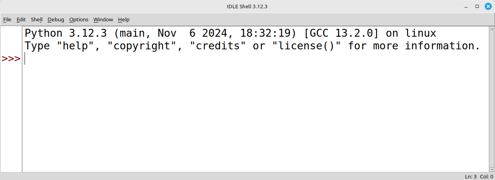
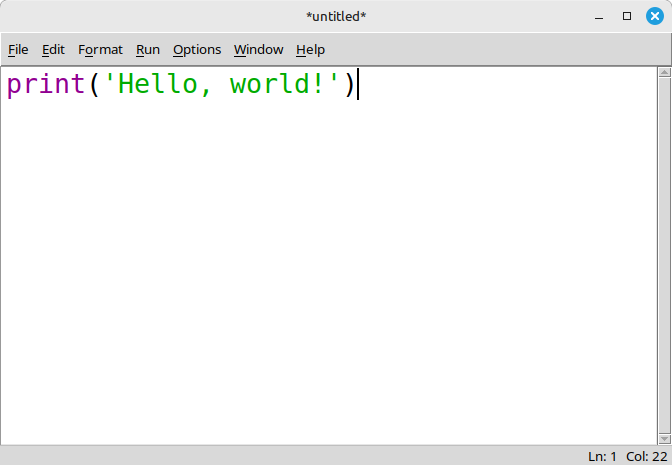
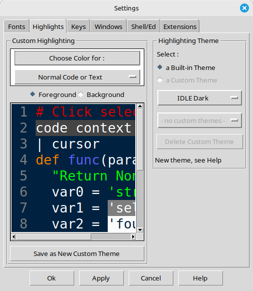
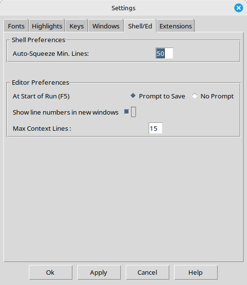
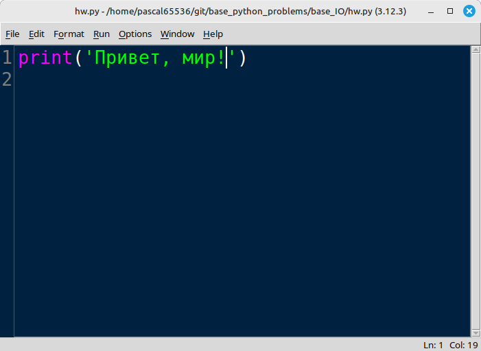
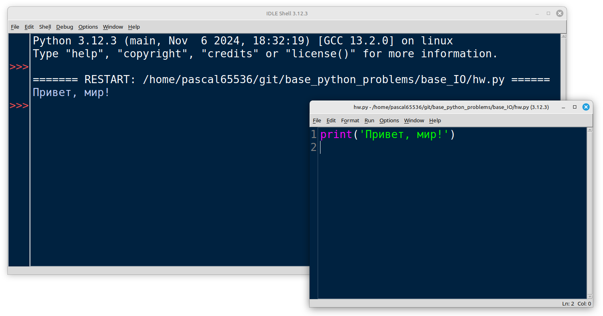

# 020. Перед началом

Всем привет!  Вы начинаете изучать язык программирования Python. Чтобы выполнять задания вам понадобится установить на свой компьютер сам Python. Его можно скачать с официального сайта [https://www.python.org/downloads/](https://www.python.org/downloads/)

Скачав инсталлятор, сразу установите. Тогда мы сможем начать прямо сейчас.

В комплекте с интерпретатором языка программирования идёт среда разработки IDLE. Это самая простая среда разработки, на следующем уроке вы узнаете, где настоящие программисты пишут код.
### **IDLE**

Примерно так выглядит IDLE, когда вы запускаете его впервые.

Это консоль. Здесь будет показан результат работы вашей программы. Чтобы начать писать код, нажмите `File - New File`

Новое окно предназначено для работы с текстом вашей программы. Напишите код, который приведён на изображении.

Для того, чтобы выполнить программу нужно сначала её сохранить. Для сохранения нажмите `File - Save`

**NB:** Для работы создайте новую папку на жестком диске своего компьютера и сохраняйте программы в неё. Придумывайте такие имена, чтобы потом было легко ориентироваться по именам файлов.

### Настройки IDLE

Обычто программисты смотрят на код программы очень долго. От белого фона может заболеть голова или устать глаза. Давайте изменим фон. Для того, чтобы изменить фон нажмите `Options - Configure IDLE`

Найдите вкладку `Hilights` на ней блок `Hilights Theme` и выберите из выпадающего списка `IDLE Dark`

Для того, чтобы говорить о программе, показывая её код, программисты говорят о конкретных строках программы, указывая, например, на ошибку или на интересную функцию.

Чтобы включить нумерацию строк, поставьте галочку в `Shell/Ed - Show line numbers in new windows`

Теперь всё готово. Можно начинать писать код!

Чтобы выполнить программу нажмите `File - Save` а затем `Run - Run Model`

Результат работы вы увидите в консоли. Это будет единственный способ узнать, что сделала ваша программа, пока мы не освоим файлы.

