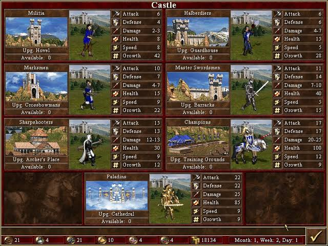
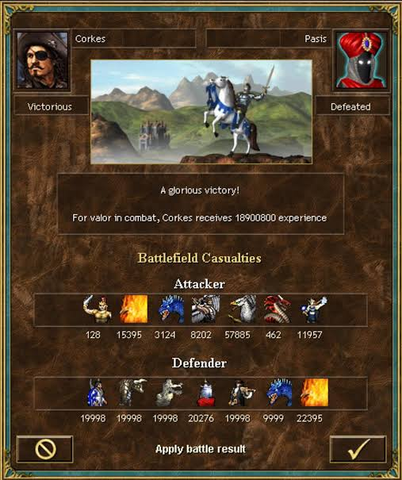

# Что такое ООП и зачем оно нужно

Представьте, что вы пишете RPG «Подземелье». Есть герой, есть гоблин, есть меч, есть зелье. Если писать это без ООП, получится набор отдельных функций и переменных:


```python
hero_name = "Артур"
hero_hp = 100
hero_attack = 10

goblin_name = "Гоблин"
goblin_hp = 50
goblin_attack = 7

def hero_attack_goblin():
    global goblin_hp
    goblin_hp -= hero_attack
```


Проблема очевидна: данные героя и гоблина перемешаны, функции знают о глобальных переменных, а если героев станет трое — придётся заводить `hero1_hp`, `hero2_hp`, `hero3_hp`. Это быстро превращается в лапшу.

**ООП** предлагает сгруппировать данные и действия над ними в одно целое — объект. Герой — это объект, у которого есть имя, здоровье, атака и умение бить. Гоблин — тоже объект, но со своими значениями.


```python
class Character:
    def __init__(self, name, hp, attack):
        self.name = name
        self._hp = hp
        self.attack = attack

    def take_damage(self, damage):
        self._hp = max(0, self._hp - damage)
        return self._hp > 0
```


Теперь у нас есть **класс** `Character` — чертёж. И **объекты** — конкретные экземпляры:


```python
hero = Character("Артур", 100, 10)
goblin = Character("Гоблин", 50, 7)
```


Каждый объект помнит свои значения. Функции больше не нужно искать, чей это HP — она работает с конкретным объектом.

**Главная идея:** класс — это шаблон, объект — это конкретная вещь, сделанная по шаблону. В RPG это критично: у вас могут быть сотни монстров, но описан один класс `Character`.

## Класс и объект: как создать героя, врага, предмет

Класс в Python объявляется ключевым словом `class`. Имя класса пишем с большой буквы. Это первый случай, когда мы что-то назвали с большой буквы. Если название составное, то используем camel-case, например `CompanyStore`.


```python
class Character:
    pass
```


Пустой класс бесполезен, но он уже создаёт новый тип. Можно создать экземпляр:


```python
hero = Character()
```


Экземпляр класса можно попытаться напечатать или спросить его тип.


```python
print(hero)

print(type(hero))

# Вывод
<__main__.Character object at 0x7358079dc2f0>
<class '__main__.Character'>
```


Видно, что объект не очень-то разговорчив, но показывате область памяти, где он находится. И сообщает, что он принадлежит классу `Character`.

Пока у героя ничего нет. Чтобы у объекта появились атрибуты, их нужно либо задать вручную, либо описать в `__init__`.

**Ручной способ** :


```python
hero = Character()
hero.name = "Артур"
hero.hp = 100
hero.attack = 10
```


Так делать не правильно, потому что у разных объектов будут разные атрибуты. Программисты - люди не надёжные и могут ошибаться.


Когла я говорю об объекте и атрибутах, я представляю себе игольницу с крышечкой. Воткнул в подушечку иглы, накрыл крышкой и можешь безопасно передавать, хранить или носить.

## Правильный способ — `__init__`:


```python
class Character:
    def __init__(self, name, hp, attack):
        self.name = name
        self._hp = hp
        self._max_hp = hp
        self.attack = attack
```


Теперь при создании объекта нужно передать параметры:


```python
hero = Character("Артур", 100, 10)
goblin = Character("Гоблин", 50, 7)
```


`self` — это ссылка на сам объект. Когда вы пишете `self.name = name`, Python кладёт значение в конкретный объект. У `hero` будет `name = "Артур"`, у `goblin` — `name = "Гоблин"`. Это два разных объекта с разными данными.

**Проверка:**


```python
print(hero.name)    # Артур
print(goblin.name)  # Гоблин
```


**Важно:** класс — это не объект. Это описание. Объекты появляются, когда вы вызываете класс как функцию: `Character(...)`.

В RPG у вас будут классы `Character`, `Item`, `Location`, `Quest`. Каждый описывает свою сущность.

## Атрибуты и методы: характеристики и действия

**Атрибут** — это данные объекта. У персонажа это `name`, `_hp`, `attack`. У предмета — `name`, `weight`, `price`.

**Метод** — это функция внутри класса. Она всегда принимает `self` первым параметром.


```python
class Character:
    def __init__(self, name, hp, attack):
        self.name = name
        self._hp = hp
        self._max_hp = hp
        self.attack = attack

    def take_damage(self, damage):
        self._hp = max(0, self._hp - damage)
        return self._hp > 0

    def heal(self, amount):
        self._hp = min(self._max_hp, self._hp + amount)

    def is_alive(self):
        return self._hp > 0
```


Теперь у героя есть действия: получить урон, полечиться, проверить, жив ли он.


```python
hero = Character("Артур", 100, 10)
hero.take_damage(30)
print(hero._hp)  # 70
hero.heal(10)
print(hero._hp)  # 80
print(hero.is_alive())  # True
```


**Ключевой момент:** метод вызывается через точку от объекта: `hero.take_damage(30)`. Python автоматически подставляет `hero` в `self`. То есть `hero.take_damage(30)` — это фактически `Character.take_damage(hero, 30)`.

**Атрибуты живут в объекте, методы — в классе.** Если создать тысячу героев, метод `take_damage` будет один, а вот `_hp` — у каждого свой.


```python
hero1 = Character("Артур", 100, 10)
hero2 = Character("Ланселот", 120, 12)
hero1.take_damage(50)
print(hero1._hp)  # 50
print(hero2._hp)  # 120 — не изменилось
```


Это основа ООП и если хотите, всей нашей RPG - у каждого персонажа своё HP, но логика атаки общая.



Смотрите, как у классиков - сколько бы NPC не было, к какой расе бы они не принадлежали - у всех одинаковые атрибуты, а вот их значение зависит от обстоятельств. 

## Инкапсуляция: почему HP нельзя менять напрямую

Представьте, что игрок может написать:


```python
hero._hp = 999999
```


И всё — баланс сломан. В RPG это критично: если здоровье можно менять как угодно, никакие правила боя не работают.



Если напрямую изменить количество NPC, то исход битвы будет предопределён.

**Инкапсуляция** — это соглашение: «не трогай внутренние данные напрямую, используй методы». В Python нет настоящей приватности, но есть договорённость: атрибуты с одним подчёркиванием (`_hp`) считаются внутренними.


```python
class Character:
    def __init__(self, name, hp, attack):
        self.name = name
        self._hp = hp
        self._max_hp = hp
        self.attack = attack

    def take_damage(self, damage):
        self._hp = max(0, self._hp - damage)
        return self._hp > 0

    def heal(self, amount):
        self._hp = min(self._max_hp, self._hp + amount)

    def get_info(self):
        return {
            'name': self.name,
            'hp': self._hp,
            'max_hp': self._max_hp,
            'attack': self.attack,
        }
```


Теперь снаружи есть только `take_damage`, `heal`, `get_info`. Игрок не может напрямую записать `hero._hp = 999999` — это считается дурным тоном. Технически Python это позволит, но код перестаёт быть предсказуемым: методы `heal` и `take_damage` проверяют границы, а прямое присваивание — нет.

**Правило:** если у вас есть инвариант (например, `0 <= _hp <= _max_hp`), прячьте данные за методами, которые этот инвариант соблюдают.

В RPG это особенно важно: если игрок сможет менять `_hp` напрямую, он обойдёт все механики боя.

## Инициализация: `__init__` и защита инвариантов

`__init__` — это инициализатор. Он вызывается автоматически, когда вы создаёте объект:


```python
hero = Character("Артур", 100, 10)  # __init__ вызывается здесь
```


Задача `__init__` — привести объект в корректное состояние. В RPG это значит:

- задать имя;
- установить здоровье;
- запомнить максимум здоровья (чтобы `heal` не превысил его);
- задать атаку;
- задать уровень и опыт.


```python
class Character:
    def __init__(self, name, hp, attack):
        self.name = name
        self._hp = hp
        self._max_hp = hp
        self.attack = attack
        self._level = 1
        self._experience = 0
```


**Важно:** `_max_hp` нужен, чтобы `heal` знал границу. Если бы мы хранили только `_hp`, то при лечении могли бы перевалить за максимум.


```python
def heal(self, amount):
    self._hp = min(self._max_hp, self._hp + amount)
```


**Проверка инварианта в `__init__`.** Если игрок передаст отрицательное HP — это ошибка. Можно явно проверять:


```python
class Character:
    def __init__(self, name, hp, attack):
        if hp <= 0:
            raise ValueError("HP должно быть положительным")
        if attack < 0:
            raise ValueError("Атака не может быть отрицательной")
        self.name = name
        self._hp = hp
        self._max_hp = hp
        self.attack = attack
```


Теперь создать персонажа с отрицательным HP нельзя. Это защита от ошибок на раннем этапе.

**В RPG** `__init__` — это момент «рождения» персонажа. Всё, что должно быть у него с самого начала (уровень 1, опыт 0, пустой инвентарь), задаётся именно здесь.

## Полиморфизм: разные враги — один интерфейс

Полиморфизм — это когда разные объекты умеют одно и то же действие, но делают его по-своему.

В RPG у нас есть `Warrior` и `Mage`. Оба — персонажи, оба умеют атаковать. Но воин может блокировать удар щитом, а маг — кидать файербол.

### Базовый класс:


```python
class Character:
    def __init__(self, name, hp, attack):
        self.name = name
        self._hp = hp
        self._max_hp = hp
        self.attack = attack

    def take_damage(self, damage):
        self._hp = max(0, self._hp - damage)
        return self._hp > 0

    def is_alive(self):
        return self._hp > 0
```


### Наследники:


```python
class Warrior(Character):
    def shield_block(self, incoming_damage):
        return incoming_damage // 2


class Mage(Character):
    def __init__(self, name, hp, attack, mana=100):
        super().__init__(name, hp, attack)
        self._mana = mana

    def fireball(self):
        if self._mana < 30:
            return None
        self._mana -= 30
        return self.attack * 2
```


### Полиморфная функция боя:


```python
def battle(char1, char2):
    rounds = 0
    current, other = char1, char2

    while char1.is_alive() and char2.is_alive():
        rounds += 1

        # Полиморфизм: если у объекта есть fireball — используем
        if hasattr(current, 'fireball') and current._mana >= 30:
            damage = current.fireball()
        else:
            damage = current.attack

        # Полиморфизм: если у защищающегося есть shield_block — используем
        if rounds % 2 == 0 and hasattr(other, 'shield_block'):
            damage = other.shield_block(damage)

        other.take_damage(damage)
        current, other = other, current

    winner = char1 if char1.is_alive() else char2
    loser = char2 if char1.is_alive() else char1

    return {'winner': winner.name, 'loser': loser.name, 'rounds': rounds}
```


**Ключевая идея:** `battle` не проверяет `isinstance(char1, Warrior)`. Она просто вызывает `take_damage`, `is_alive`, и если есть `fireball` — использует его. 

В RPG это критично: можно добавить объект `Archer` с методом `snipe()`, персонажа `Rogue` с методом `backstab()`, а в `battle` не нужно менять. Главное — чтобы у них были `is_alive`, `take_damage`, `attack`.

## Переопределение операторов: сравнение героев и начисление опыта

Python позволяет работать с самодельными объектами так же, как со встроенными. Помните фразу «в Питоне всё — объект»? Числа, строки, списки — это объекты классов `int`, `str`, `list`. И для них работают операторы: `5 + 3`, `"a" == "b"`, `[1, 2] < [1, 3]`, `bool([])`. Всё потому, что внутри этих классов определены специальные методы с двойными подчёркиваниями — **dunder-методы** (от _double underscore_).

Когда Python видит `a + b`, он на самом деле вызывает `a.__add__(b)`. Когда видит `a == b` — вызывает `a.__eq__(b)`. Когда видит `if a:` — вызывает `a.__bool__()`. Это и есть механизм переопределения операторов: если у вашего класса есть нужный dunder-метод, синтаксис заработает для ваших объектов.

Разберёмся, как научить объекты RPG работать с операторами `+`, `==`, `<`, `bool()`.

### Начисление опыта через `+`:


```python
class Character:
    def __add__(self, experience):
        self._experience += experience
        while self._experience >= 100:
            self._experience -= 100
            self._level += 1
            self._max_hp += 20
            self.attack += 5
        return self
```


Теперь можно писать:


```python
hero = Character("Артур", 100, 10)
hero + 150
print(hero._level)  # 2
print(hero._max_hp)  # 120
print(hero.attack)  # 15
```


Возврат `self` позволяет строить цепочки: `hero + 50 + 50`.

### Сравнение по уровню и опыту:


```python
def __eq__(self, other):
    if not isinstance(other, Character):
        return NotImplemented
    return (self._level, self._experience) == (other._level, other._experience)

def __lt__(self, other):
    if not isinstance(other, Character):
        return NotImplemented
    return (self._level, self._experience) < (other._level, other._experience)
```


Теперь можно сравнивать героев:


```python
hero1 = Character("Артур", 100, 10)
hero2 = Character("Ланселот", 100, 10)
hero1 + 100
print(hero1 > hero2)  # True
```


### Проверка «жив ли» через `bool`:


```python
def __bool__(self):
    return self.is_alive()
```


Теперь можно писать:


```python
if hero:
    print("Герой в бою")
else:
    print("Герой пал")
```


Возврат `NotImplemented` — это стандарт Python. Если сравнить `Character` с числом, Python попробует `Character.__eq__(5)`, получит `NotImplemented` и сам выбросит `TypeError`. Это правильнее, чем явно бросать исключение: так другие классы могут попробовать сравнение со своей стороны.

В RPG это позволяет:

- сортировать героев по силе;
- сравнивать, кто опытнее;
- использовать героя в условиях `if hero:` вместо `if hero.is_alive()`.

## Наследование: базовый `Character` и его наследники

**Наследование** — это когда один класс берёт всё от другого и добавляет своё.


```python
class Character:
    def __init__(self, name, hp, attack):
        self.name = name
        self._hp = hp
        self._max_hp = hp
        self.attack = attack

    def take_damage(self, damage):
        self._hp = max(0, self._hp - damage)
        return self._hp > 0

    def is_alive(self):
        return self._hp > 0
```


`Warrior` наследуется от `Character`:


```python
class Warrior(Character):
    def __init__(self, name, hp, attack):
        super().__init__(name, hp, attack)

    def shield_block(self, incoming_damage):
        return incoming_damage // 2
```


Что делает `super()`? Он вызывает метод родителя. В `Warrior.__init__` мы вызываем `Character.__init__`, чтобы не дублировать код. Если бы мы написали `self._hp = hp` вручную, то при изменении логики в `Character` пришлось бы менять и в `Warrior`.

## Mage добавляет `mana`:


```python
class Mage(Character):
    def __init__(self, name, hp, attack, mana=100):
        super().__init__(name, hp, attack)
        self._mana = mana

    def fireball(self):
        if self._mana < 30:
            return None
        self._mana -= 30
        return self.attack * 2
```


Переопределение метода. Если в `Warrior` нужен свой `get_info`, он переопределяется:


```python
class Warrior(Character):
    def get_info(self):
        info = super().get_info()
        info['class'] = 'Warrior'
        return info
```


Здесь `super().get_info()` возвращает базовый словарь, а `Warrior` добавляет к нему ключ `'class'`.

### Проверка наследования:


```python
w = Warrior("Артур", 150, 15)
print(isinstance(w, Character))  # True
```


### MRO (Method Resolution Order).

Если у `Warrior` нет метода `take_damage()`, Python ищет его в `Character`.  Если не нашлось в `Character`, будет искать в самом объекта. Это цепочка: `Warrior -> Character -> object`. Посмотреть можно так:


```python
print(Warrior.__mro__)
```


В RPG наследование позволяет описывать разные классы персонажей, не дублируя базовую логику. `Warrior`, `Mage`, `Archer`, `Rogue` — все они наследуются от одного родительского класса `Character`, но добавляют свои умения.

## Инвентарь: словарь внутри объекта

В RPG у персонажа есть инвентарь. Это словарь: `{'зелье': 2, 'меч': 1}`.


```python
class Character:
    def __init__(self, name, hp, attack):
        self.name = name
        self._hp = hp
        self._max_hp = hp
        self.attack = attack
        self._inventory = {}

    def add_item(self, item_name, quantity=1):
        self._inventory[item_name] = self._inventory.get(item_name, 0) + quantity

    def use_item(self, item_name):
        if item_name not in self._inventory or self._inventory[item_name] <= 0:
            return False

        if item_name == 'зелье':
            self.heal(50)
            self._inventory[item_name] -= 1
            return True
        elif item_name == 'меч':
            self.attack += 10
            self._inventory[item_name] -= 1
            return True
        return False

    def get_inventory(self):
        return self._inventory.copy()
```


Почему `copy()`? Если вернуть сам словарь, игрок, или в нашем случае программист, сможет изменить инвентарь в обход методов:


```python
inv = hero.get_inventory()
inv['зелье'] = 999  # изменит инвентарь героя!
```


`copy()` возвращает копию — оригинал защищён.

**Использование:**


```python
hero = Character("Артур", 100, 10)
hero.add_item('зелье', 3)
hero.take_damage(50)
hero.use_item('зелье')
print(hero._hp)  # 80
print(hero.get_inventory())  # {'зелье': 2}
```


**Что важно:** `use_item()` возвращает `True` или `False`, чтобы вызывающий код знал, удалось ли действие. Это позволяет методу не падать с ошибкой, а сообщить о результате.

## Как работает `assert` в тестах

`assert` — это проверка. Если условие истинно — ничего не происходит. Если ложно — программа падает с `AssertionError`.


```python
hero = Character("Артур", 100, 10)
assert hero._hp == 100, "Начальное HP должно быть 100"
```


Если `_hp` не равно 100, Python выбросит:

```
AssertionError: Начальное HP должно быть 100
```

**Как это используется в тестах.** Вы пишете последовательность проверок, и если хоть одна падает — вы знаете, что именно сломалось.

### Пример теста для боя:


```python
def test_take_damage():
    hero = Character("Артур", 100, 10)
    assert hero.take_damage(30) is True, "После 30 урона герой жив"
    assert hero._hp == 70, "HP должно быть 70"
    assert hero.take_damage(80) is False, "После 80 урона герой мёртв"
    assert hero._hp == 0, "HP не может быть отрицательным"
```


### Проверка исключений

Иногда нужно убедиться, что код падает с нужной ошибкой:


```python
def test_negative_hp():
    try:
        Character("Тест", -10, 10)
        assert False, "Должно быть исключение"
    except ValueError:
        pass
```


### Проверка наследования


```python
def test_warrior_is_character():
    w = Warrior("Артур", 150, 15)
    assert isinstance(w, Character), "Warrior должен быть Character"
```


### Проверка полиморфизма


```python
def test_battle_returns_dict():
    w = Warrior("Артур", 100, 10)
    m = Mage("Гэндальф", 80, 15, 100)
    result = battle(w, m)
    assert 'winner' in result
    assert 'loser' in result
    assert 'rounds' in result
```


### Почему `assert` удобен

Не нужно лишних импортов. Нет никаких зависимостей - все поставляется из коробки вместе с Python.
Можно объяснить программисту, что именно не так с программой. Для этого есть текстовые комментарии после запятой.
Тесты идут один за одним, как линейная программа. Если что-то сломалось, то нужно остановиться и починить. 

**Ограничение:** `assert` можно отключить флагом `-O` (оптимизация). Поэтому в продакшене `assert` не используют для проверки входных данных — только для тестов и внутренних инвариантов.

## Подведём итоги

1. **ООП** — способ группировать данные и действия.
2. **Класс и объект** — чертёж и конкретная вещь.
3. **Атрибуты и методы** — характеристики и умения.
4. **Инкапсуляция** — защита внутренних данных.
5. **Инициализация** — приведение объекта в корректное состояние.
6. **Полиморфизм** — один интерфейс, но разные реализации.
7. **Dunder-методы** — обучение объектов операторам.
8. **Наследование** — переиспользование кода через `super()`.
9. **Инвентарь** — композиция и защита через `copy()`.
10. **`assert`** — проверка инвариантов и тесты.

