# Создание проекта на Git

## Вокабуляр

- **Репозиторий (Repository)**: Это место, где хранятся все файлы проекта и история изменений. Репозиторий может быть локальным (на вашем компьютере) или удалённым (например, на GitHub).
- **Коммит (Commit)**: Это снимок состояния файлов в репозитории в определённый момент времени. Каждый коммит имеет уникальный идентификатор и сообщение, описывающее изменения.
- **Ветка (Branch)**: Ветки позволяют работать над различными функциями или исправлениями одновременно, не мешая основной кодовой базе. Основная ветка обычно называется `main` или `master`.
- **Слияние (Merge)**: Процесс объединения изменений из одной ветки в другую. Например, после завершения работы над новой функцией её изменения можно слить с основной веткой.
- **Удалённый репозиторий (Remote Repository)**: Это репозиторий, который находится на сервере (например, GitHub, GitLab). Удалённые репозитории позволяют команде совместно работать над проектом.

## Пошаговая инструкция

1. Установите GitHub Desktop.
2. Зарегистрируйтесь на github.com
3. На вкладке repositories нажмите New, чтобы создаст новый проект.
4. Название проекта должно отображать название изучаемого предмета.
5. Нажмите Add .gitignore, и выберите Python, чтобы добавить шаблон файла с исключениями для Питона.
6. Создайте репозиторий для своего проекта - Create repository.
7. Выберите Code -> Local -> SSH -> Open with GitHub Desktop
8. Разрешите открывать ссылки в GitHub Desktop. Если приложение GitHub Desktop не установлено, то установите его и повторите попытку.
9. Запомните путь, куда будет клонирован ваш репозиторий. Оставьте по-умолчанию или измените путь. Нажмите Clone.
10. Основное окно программы GitHub Desktop.
11. Нажмите кнопку Open Visual Studio Code, чтобы открыть программу в своей IDE.
12. Создайте простую программу в VSC и сохраните её.
13. Вернитесь в GitHub Desktop и увидите, что все изменения, что вы внесли в проект, GitHub Desktop отследила. В левом нижнем углу окна напишите название коммита и нажмите Commit 1 file to main.
14. Теперь в главном окне программы появилась кнопка Push origin, нажмите её, чтобы отправить свои изменения в репозиторий.
15. Вернитесь в свой проект на GitHub и обновите страницу.
16. Видно, что файл, который мы только что создали на своём компьютере, теперь сохранён в репозитории. Название коммита также указано.
17. Нажмите кнопку Add a README и создайте файл README.md
18. Коротко опишите свой проект. Используйте язык разметки Markdown, чтобы страница выглядела более презентабельной.
19. После того, как содержимое файла будет заполнено, сделайте commit. Нажмите кнопку Commit changes ...
20. Подтвердите создание коммита - кнопка Commmit changes
21. Теперь в вашем репозитории стало на один файл больше. Содержимое README файла видно как описание проекта.
22. Нажмите Settings -> Add people, чтобы добавить коллег в свой проект для совместной работы.
23. Добавить пользователя pascal65536 в контрибьюторы, для проверки вашей работы.
24. Если работа групповая, то контрибьютором должен быть каждый из участников команды.
25. Вернитесь в GitHub Desktop и нажмите кнопку Fetch origin загрузите сведения об изменения в репозитории.
26. Появится кнопка Pull origin. Нажмите её и загрузите изменения из репозитория.
27. Откройте VSC и убедитесь, то новый файл README.md теперь у вас и вы можете его редактировать.

---

# Создание веток и реквестов

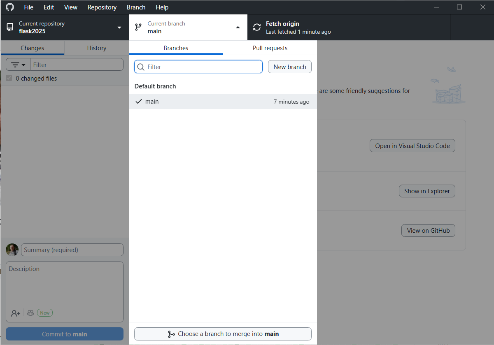

В программе GitHub Desktop нажмите кнопку `Current branch`.

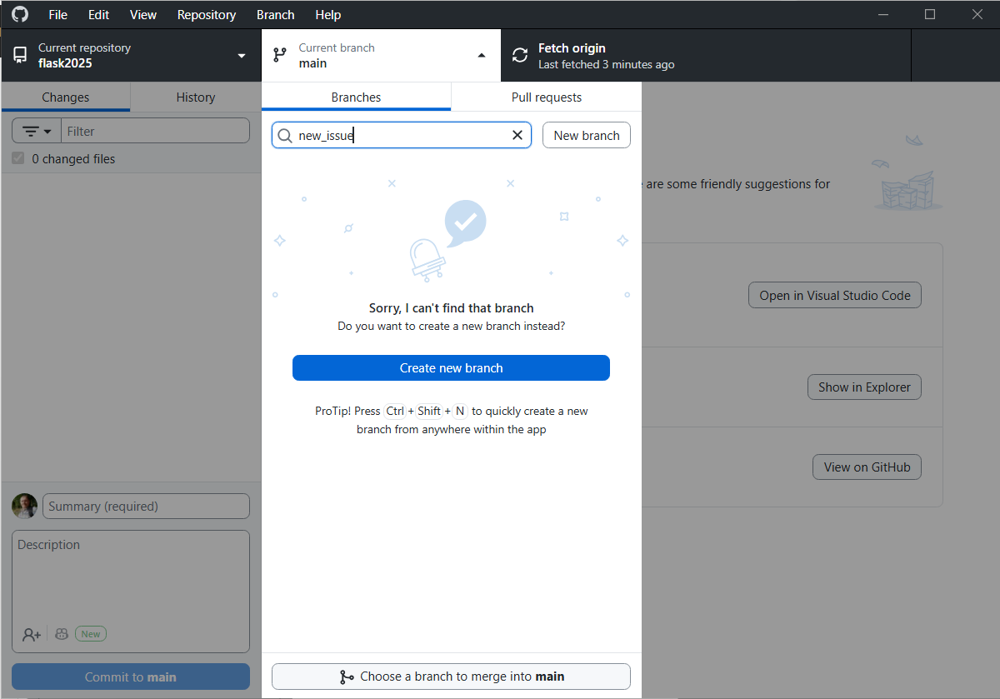

Введите название ветки и нажмите кнопку `New branch`.

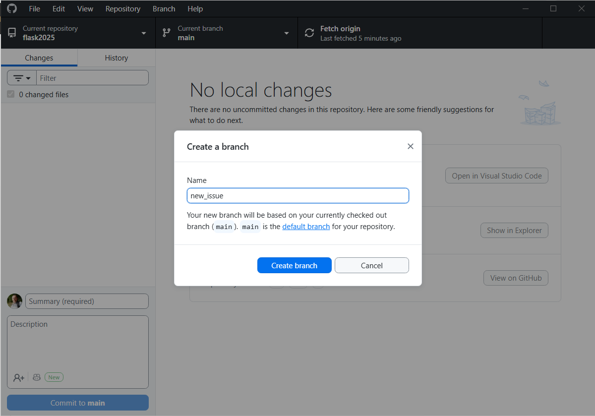

Подтвердите создание нового бранча.

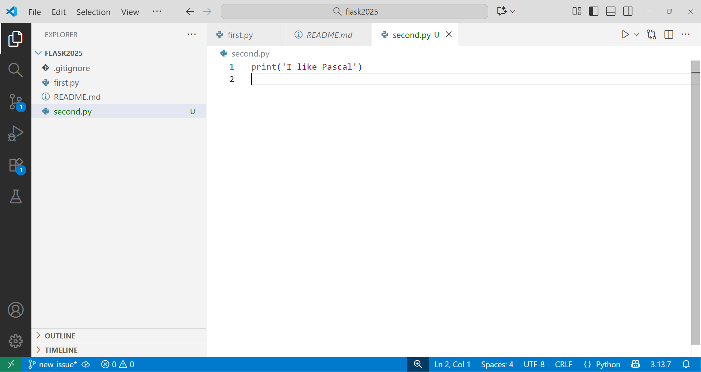

Вернитесь в VSC и создайте новый файл.

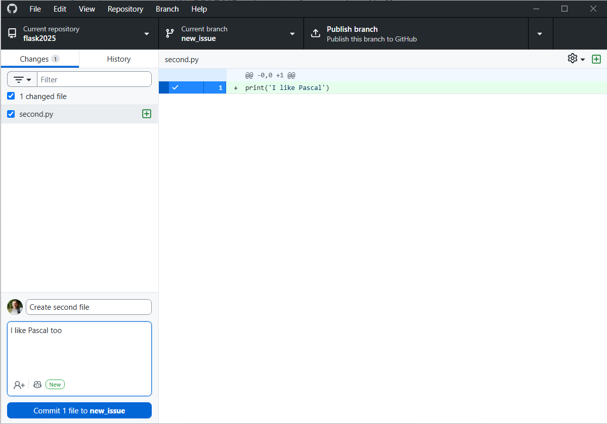

В программе GitHub Desktop создайте коммит.

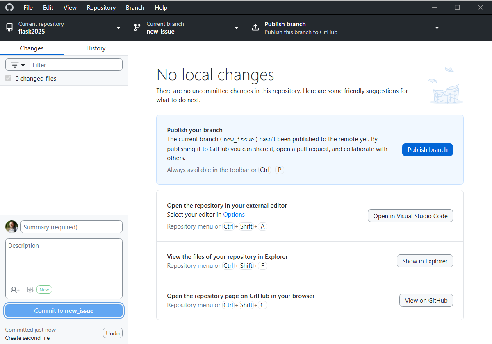

Сейчас репозиторий не знает о том, что у вас есть новая ветка. Нужно опубликовать этот бранч. Нажмите `Publish branch`.

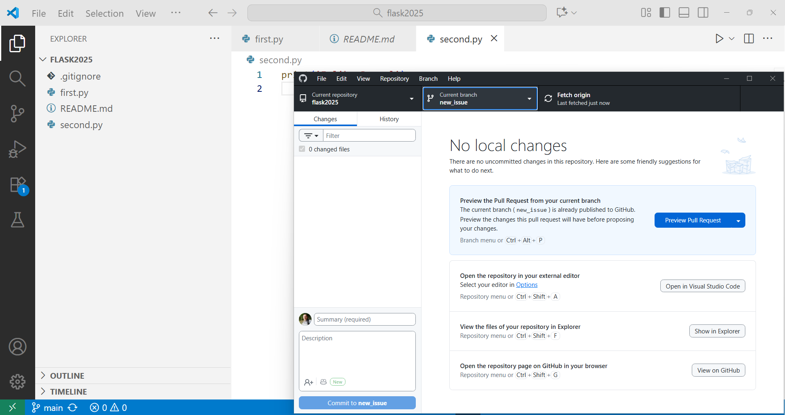

Откройте две программы так, как показано на скриншоте. С помощью кнопки `Current branch` переключайте ветки и увидите, что количество файлов в VSC отличается.

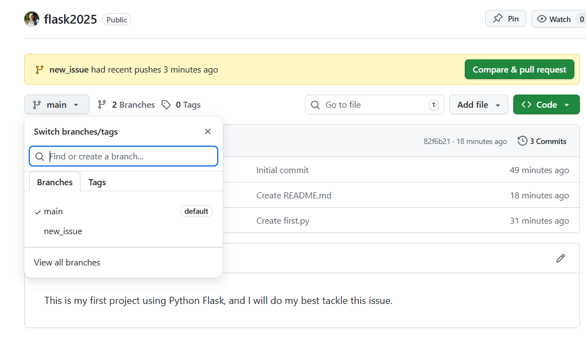

Перейдите в GitHub и увидите, что здесь тоже появилась вторая ветка. Между ветками можно переключаться так, как показано на скриншоте.

Кроме того, появилась кнопка `Compare & pull request` для того, чтобы объединить две ветки.

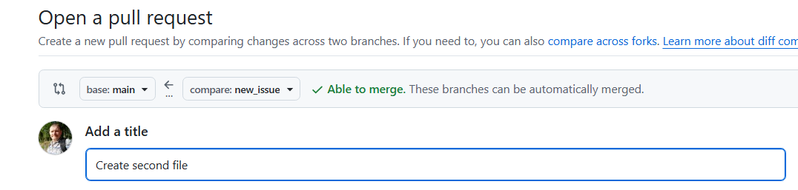

Убедитесь, что ветки `main` и `new_issue` расположены именно так. Мы будем сливать ветку `new_issue` в main (когда веток будет больше, то эта проверка станет актуальной). Зелёная галочка `Able to merge` говорит о том, что слияние возможно и нет никаких проблем.

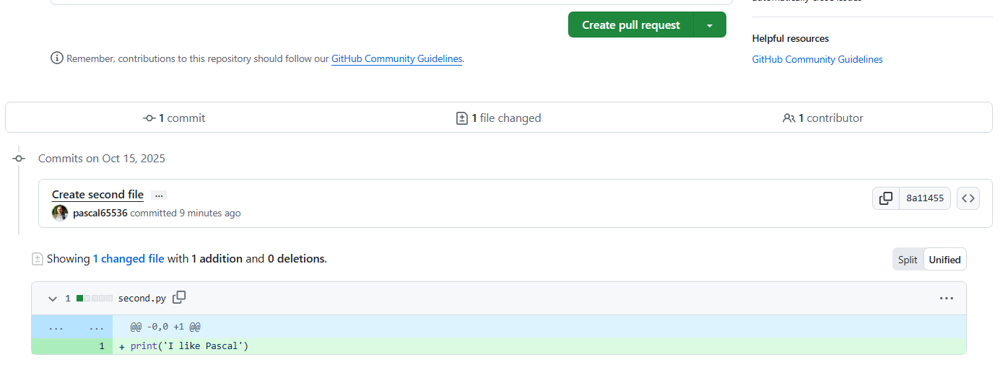


На этом же экране ниже вы увидите различия между ветками и кнопку `Create pull request`. Нажмите её.

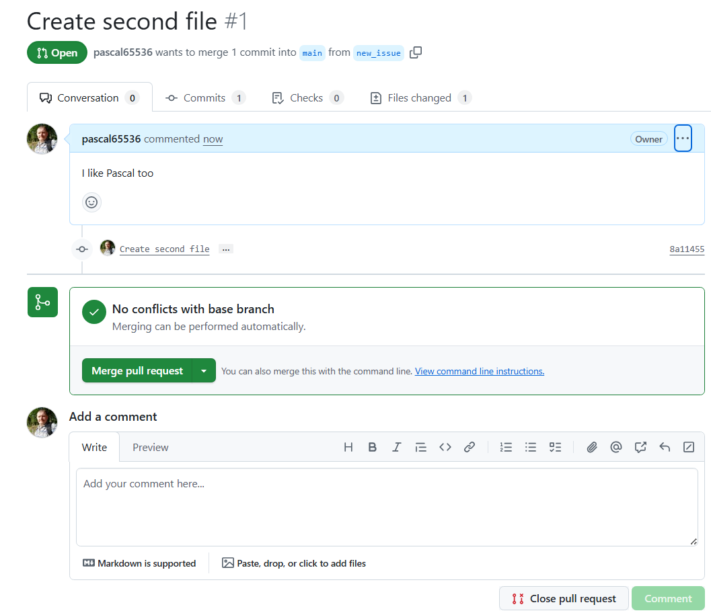

Теперь вы можете выбрать ответственного за слияние веток. Можете самостоятельно нажать кнопку `Merge pull request` и тогда слияние веток произойдет. Можно отложить слияние и оставить комментарий команде. Можете нажать кнопку `Close pull request` и отказать в слиянии веток.

Нажмите `Merge pull request`.

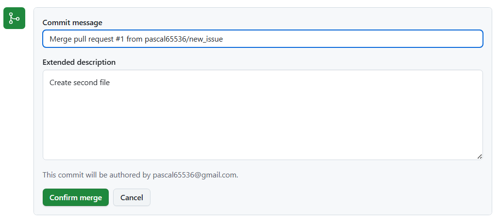


Подпишите коммит, если нужно и подтвердите слияние `Confirm merge`.

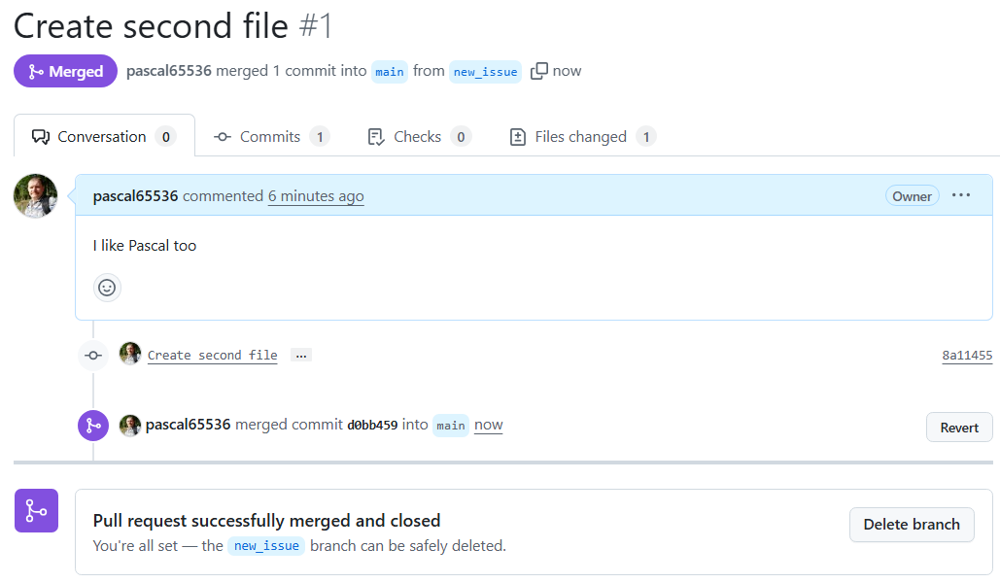


Теперь можно узнать все о слиянии веток. Какой коммит на какой ветке был слит с веткой main. Кто принял решение соединить ветки и когда. У точки слияния есть метка `d0bb459` и можно увидеть какие именно изменения были внесены. Можно отменить слияние кнопкой `Revert`. Можно удалить ветку кнопкой `Delete branch`.

Нажмите `Delete branch`.

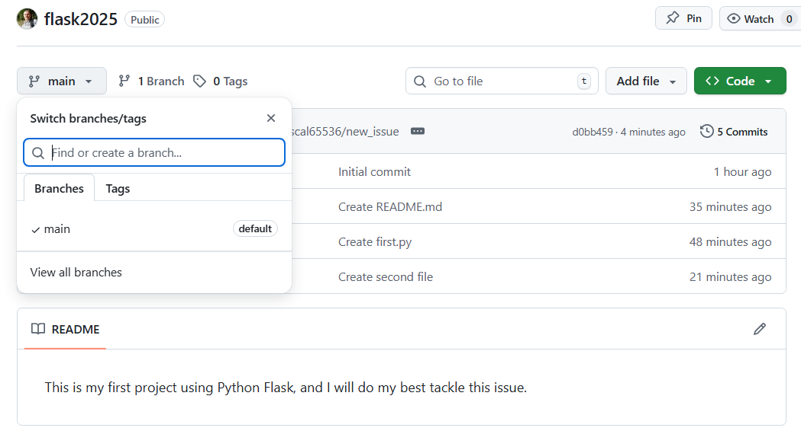

В репозитории видно, что осталась только одна ветка, а файлов стало больше - добавились файлы из другой ветки.

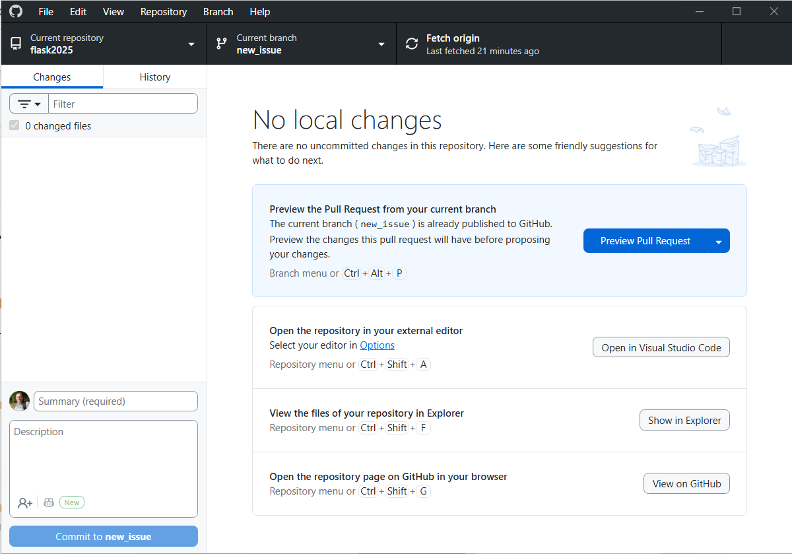

В программе GitHub Desktop видно, что осталась вторая ветка и требуются какие-то действия. Программа ещё не знает, что в репозитории что-то происходило. Обновите информацию, нажмите `Fetch origin`.

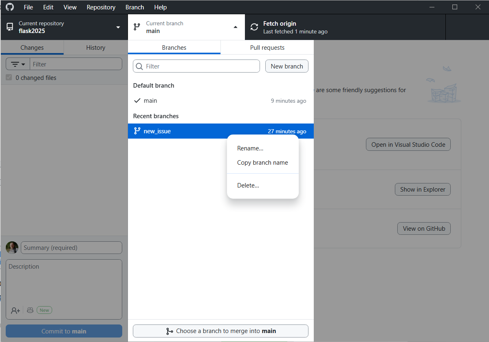

Переключитесь на ветку main, ПКМ на `new_issue` и удалите этот бранч.

## Советы для работы в группе

- **Часто коммитьте**: Делайте коммиты небольшими и осмысленными, чтобы легче было отслеживать изменения.
- **Используйте ветки**: Создавайте отдельные ветки для каждой новой функции или исправления, чтобы не мешать другим разработчикам.
- **Проверяйте изменения перед слиянием**: Используйте `git diff` для просмотра различий перед слиянием веток.
- **Обсуждайте изменения**: Используйте pull request (или merge request) для обсуждения изменений перед их слиянием в основную ветку.

# Основные консольные команды Git

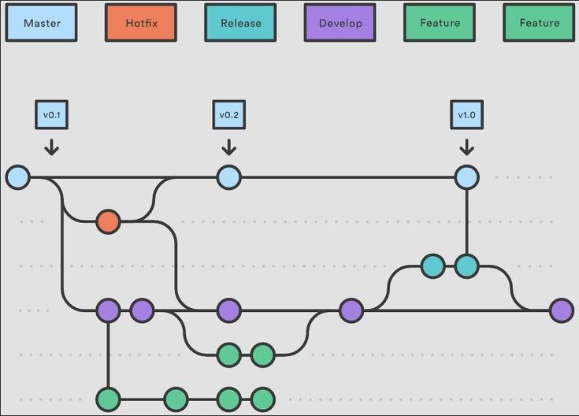

**Создание репозитория:**

```bash
git init
```

**Клонирование удалённого репозитория:**

```bash
git clone <url>
```

**Проверка статуса репозитория:**

```bash
git status
```

**Добавление изменений к коммиту:**

```bash
git add <file>  # Для добавления конкретного файла

git add .       # Для добавления всех изменений
```

**Создание коммита:**

```bash
git commit -m "Сообщение о коммите"
```

**Просмотр истории коммитов:**

```bash
git log
```

**Создание новой ветки:**

```bash
git branch <имя-ветки>
```

**Переключение на другую ветку:**

```bash
git checkout <имя-ветки>
```

**Слияние веток:**

```bash
git merge <имя-ветки>
```

**Отправка изменений в удалённый репозиторий:**

```bash
git push origin <имя-ветки>
```

**Получение изменений из удалённого репозитория:**

```bash
git pull origin <имя-ветки>
```