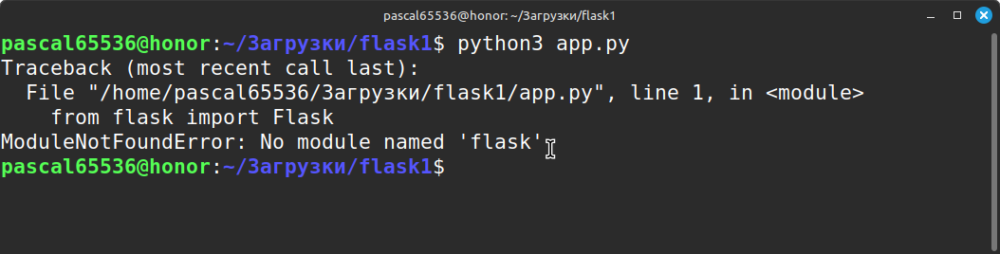
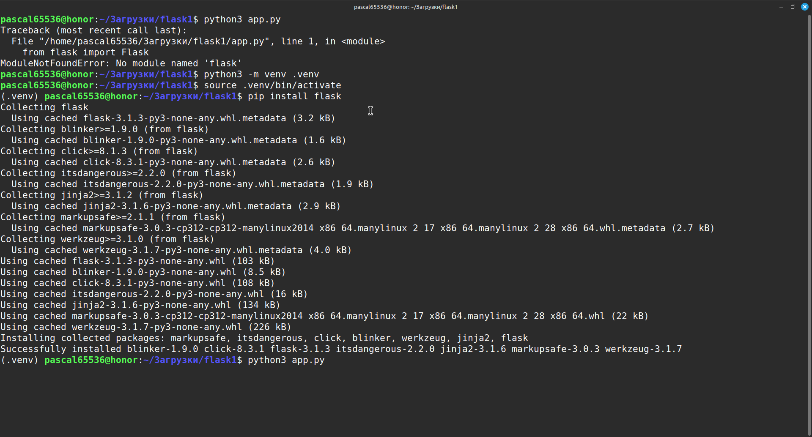
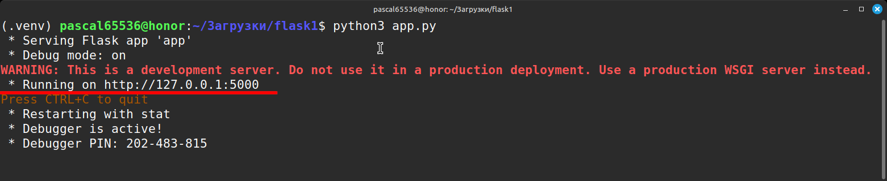

# Flask начало

## Ключевые особенности Flask:

- **Минимализм**: Flask предоставляет только базовые инструменты для создания веб-приложений, такие как маршрутизация, обработка запросов и шаблонизация. Это позволяет разработчикам выбирать и интегрировать только необходимые библиотеки и расширения.
- **Гибкость**: Благодаря модульной архитектуре Flask легко адаптировать под различные задачи. Вы можете использовать его для создания небольших сайтов, API или сложных веб-приложений.
- **Простота использования**: Flask имеет простой и понятный синтаксис, что делает его идеальным выбором для начинающих разработчиков.
- **WSGI-совместимость**: Flask совместим с различными серверами приложений WSGI, такими как Gunicorn и uWSGI.
- **Большое сообщество и множество расширений**: Flask имеет активное сообщество разработчиков, которые создают и поддерживают множество расширений, которые добавляют функциональность, например, работу с базами данных, аутентификацию, обработку форм и многое другое.

## Как работает Flask:

- **Маршрутизация**: Flask использует декораторы для определения маршрутов, которые связывают URL-адреса с функциями обработчиками.
- **Обработка запросов**: Когда пользователь отправляет запрос на определенный URL, Flask находит соответствующую функцию-обработчик и выполняет ее.
- **Шаблонизация**: Flask использует Jinja2 для рендеринга HTML-шаблонов, которые могут содержать динамический контент.
- **Ответ**: Функция-обработчик возвращает HTML-код, который Flask отправляет пользователю.

## Пример простого приложения Flask:

Посмотреть исходный код: [flask1](https://github.com/pascal65536/praxis_tmp/tree/main/theory/flask1)


```python
from flask import Flask

app = Flask(__name__)

@app.route("/")
def hello_world():
    return "Hello, World!"

if __name__ == "__main__":
    app.run(debug=True)
```


Этот код создает простое приложение Flask, которое при обращении к корневому URL ("/") возвращает строку "Hello, World!".

Сохраните файл app.py в папку flask1/ и запустите его


```bash
python app.py
```



Если встретится такая ошибка, значит у вас не установлен Flask.

Создайте виртуальное окружение, активируйте его и установите Flask

```bash
pip install flask
```



Теперь должно все заработать

```bash
python app.py
```



Откройте в браузере адрес [http://127.0.0.1:5000](http://127.0.0.1:5000) и убедитесь в том, что Flask работает

## Когда стоит использовать Flask:

- Для создания небольших веб-приложений и API.
- Когда нужна гибкость и контроль над архитектурой приложения.
- Когда требуется быстрое прототипирование.
- Когда нужно использовать определенные библиотеки и расширения.

## Недостатки Flask:

- **Минимализм**: Отсутствие встроенных функций может потребовать дополнительной работы при разработке сложных приложений.
- **Необходимость самостоятельной конфигурации**: Flask требует ручной настройки многих аспектов, таких как базы данных, аутентификация и т.д.

Flask идеально подходит для создания различных типов веб-приложений. Его простота использования и активное сообщество делают его отличным выбором как для начинающих, так и для опытных разработчиков.

## Передача параметров в адресной строке в Flask

Flask предоставляет несколько способов для передачи параметров в адресной строке URL, что позволяет создавать более динамичные и гибкие веб-приложения.

### 1. Использование переменных пути (Route parameters):

Этот метод позволяет встраивать переменные непосредственно в URL.

**Пример:**

```python
from flask import Flask

app = Flask(__name__)

@app.route('/user/<username>')
def show_user_profile(username):
    # Доступ к значению username из URL
    return f'Привет, {username}!'

if __name__ == '__main__':
    app.run(debug=True)
```

В этом примере, `/user/<username>` определяет маршрут, где `<username>` - это переменная пути.
Когда пользователь переходит по адресу `/user/john`, Flask автоматически извлекает значение `john` и передает его в функцию `show_user_profile()`.

### 2. Использование аргументов запроса (Query parameters):

Этот метод позволяет передавать параметры в виде пар "ключ-значение" после знака `?` в URL.

**Пример:**

```python
from flask import Flask, request

app = Flask(__name__)

@app.route('/search')
def search():
    query = request.args.get('q')
    if query:
        return f'Результаты поиска для: {query}'
    else:
        return 'Введите поисковый запрос'

if __name__ == '__main__':
    app.run(debug=True)
```

В этом примере, пользователь может перейти по адресу `/search?q=python` и передать поисковый запрос `python` в качестве аргумента.

Функция `request.args.get('q')` извлекает значение аргумента `q` из URL.

### Преимущества и недостатки:

| Метод | Преимущества | Недостатки |
|-------|--------------|------------|
| Переменные пути (Route parameters) | Четкая структура URL. Легко понять, какие данные передаются. | Ограниченное количество параметров. Не подходит для сложных запросов. |
| Аргументы запроса (Query parameters) | Гибкость в передаче данных. Подходит для сложных запросов. | URL может стать громоздким. Менее читабельный URL. |

### Рекомендации:

- Используйте переменные пути для передачи основных параметров, которые определяют структуру URL.
- Используйте аргументы запроса для передачи дополнительных параметров, фильтров или опций.
- Внимательно выбирайте метод передачи параметров в зависимости от конкретной задачи.
- Валидируйте и обрабатывайте переданные параметры, чтобы избежать ошибок и уязвимостей безопасности.