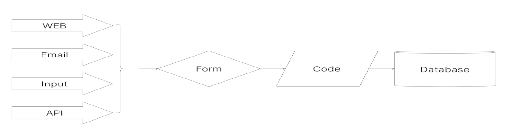
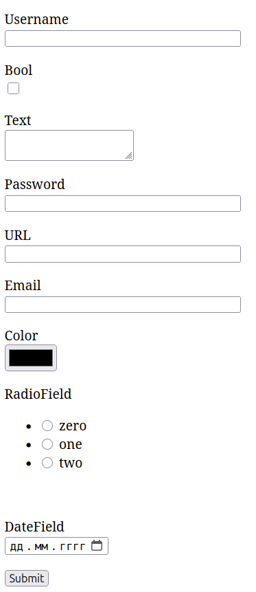

# Обработка HTML форм во Flask

Flask предоставляет простые и гибкие инструменты для обработки HTML-форм, позволяя вам собирать данные от пользователей и обрабатывать их на сервере.

## 1. Создание и обработка HTML формы во Flask

Посмотреть исходный код: [flask731](https://github.com/pascal65536/praxis_tmp/tree/main/theory/flask731)


Формы создаются с помощью стандартных HTML-тегов `<form>`, `<input>`, `<textarea>`, `<select>` и т.д. Важно указать атрибут `method` (обычно GET или POST) и `action` (URL-адрес обработчика формы).

**Пример HTML-формы:**

```html
<form method="POST" action="/">
  <label for="username">Имя пользователя:</label>
  <input type="text" id="username" name="username" required><br><br>

  <label for="email">Email:</label>
  <input type="email" id="email" name="email" required><br><br>

  <input type="submit" value="Отправить">
</form>
```

В Flask обработка форм происходит в функции представления (view function), которая обрабатывает HTTP-запрос.

**Пример кода Flask:**

```python
from flask import Flask, render_template, request

app = Flask(__name__)

@app.route('/', methods=['GET', 'POST'])
def index():
  if request.method == 'POST':
    username = request.form['username']
    email = request.form['email']

    # Обработка данных формы (например, сохранение в базе данных)
    print(f"Имя пользователя: {username}, Email: {email}")

    return "Данные успешно отправлены!"
  else:
    return render_template('index.html')

if __name__ == '__main__':
  app.run(debug=True)
```

**Пояснения:**

- `request.method` проверяет, какой HTTP-метод был использован для запроса (GET или POST).
- `request.form` содержит данные, отправленные в форме.
- В данном примере мы извлекаем значения полей `username` и `email` из `request.form`.
- После обработки данных можно вернуть пользователю сообщение об успехе или перенаправить на другую страницу.

## 2. Валидация данных:

Перед обработкой данных важно проверить их корректность. Flask не предоставляет встроенных инструментов валидации, но вы можете использовать сторонние библиотеки, такие как Flask-WTF или WTForms.

**Пример валидации с Flask-WTF:**

```python
from flask_wtf import FlaskForm
from wtforms import StringField, EmailField
from wtforms.validators import DataRequired

class MyForm(FlaskForm):
  username = StringField('Имя пользователя', validators=[DataRequired()])
  email = EmailField('Email', validators=[DataRequired()])
```

## 3. Файлы:

Если форма содержит загрузку файлов, используйте `request.files` для доступа к файлам:

```python
if 'file' in request.files:
  file = request.files['file']
  if file.filename != '':
    # Обработка файла (например, сохранение на диск)
    file.save(f'uploads/{file.filename}')
```

**Рекомендации:**

- Используйте понятные имена полей в форме и соответствующие типы данных.
- Проверяйте данные формы перед обработкой, чтобы предотвратить ошибки и уязвимости.
- Используйте фреймворки валидации для упрощения процесса проверки данных.
- При загрузке файлов проверяйте тип файла и размер, чтобы избежать проблем с безопасностью.

---

# Как работает простая HTML форма

Посмотреть исходный код: [flask732](https://github.com/pascal65536/praxis_tmp/tree/main/theory/flask732)


Для того, чтобы появилась надпись "*Форма успешно отправлена*", должны выполниться 2 условия:

1. Нужно отправить данные метододом POST
2. Поле name должно быть заполнено

Иными словами, чтобы выполнить какое-то полезное действие нужно убедиться, что данные формы заполнены корректными данными - например: пароль состоит из букв, цифр и символов, username содержит допустимые символы, возраст записан цифрами, а электронная почта выглядит как электронная почта.

Чем больше таких проверок, тем длиннее становится код. Такой код сложно отладить. Сложно найти баги и легко добавить новые. При необходимости проверить эти же данные в другом месте, придётся копировать код, нарушая принцип DRY.

Во многих популярных фреймворках есть понятие Form (не путать с HTML form). С помощью формы программист проверяет (валидирует) данные, полученные от пользователей. Однажды описав какие данные считаются валидными, программист проверяет их только таким, единственным способом. Это защищает код и хранилище данных от недопустимых данных, от пропусков, искажений и т.д.



Кроме того, форма позволяет программисту показать пользователю данные из хранилища и предложить ему отредактировать их.

# Flask-WTF

Flask-WTF — это расширение для Flask, для работы с формами. Расширение упрощает определение форм с использованием классов Python. Каждое поле формы представлено как атрибут класса, что делает структуру формы понятной и простой в управлении. Flask-WTF обеспечивает систему проверки форм. Мы можем определить валидаторы для каждого поля, чтобы гарантировать, что данные соответствуют заданнам критериям.

Flask-WTF включает встроенную поддержку защиты от подделки межсайтовых запросов (CSRF). Он автоматически добавляет токен CSRF в формы, что помогает защищаться от определенных типов веб-атак.

Flask-WTF поддерживает загрузку файлов с помощью определенных типов полей и валидаторов, таких как `FileAllowed` и `FileRequired`.

Рассмотрим пример того, как мы можем использовать Flask-WTF в приложении Flask:

## Установка

```bash
pip install flask-wtf email-validator
```

## Изменим код так, чтобы он работал с формой

Посмотреть исходный код: [flask733](https://github.com/pascal65536/praxis_tmp/tree/main/theory/flask733)

Для того, чтобы появилась надпись "Форма успешно отправлена", должны выполниться 2 условия:

1. Нужно отправить данные метододом POST
2. Форма должна быть валидной Поле name должно быть заполнено

Количество условий не изменилось, но добавилось понятие "*валидность*" формы. Появилась проверка подлинности с помощью CSRF токена. Поле name не нужно проверять на длину, оно должно быть обязательным. Для рендеринга шаблона передаётся сама форма `render_template("form.html", form=form)`. Таким образом пользователю можно передать пустую форму для заполнения и форму с данными для редактирования.

В HTML шаблоне содержится только информация о полях формы, но нет упоминания о том, как эти поля должны выглядеть.

# Добавим в форму разные поля, чтобы убедиться, что сложность HTML верстки не изменится

Сколько полей в форме, столько будет одинаковых блоков в HTML, только c разницей в названии поля.

Посмотреть исходный код: [flask734](https://github.com/pascal65536/praxis_tmp/tree/main/theory/flask734)

Обратите внимание блоки кода отличаются только названием поля формы. Их можно расположить как угодно, например в таблице или в бутстрап-карточках.



Если открыть исходный код страницы *после рендеринга* то увидим следующую картину:

```html
<form method="POST" action="">
    <input id="csrf_token" name="csrf_token" type="hidden" value="">
    <p>
        <label for="username">Username</label><br>
        <input id="username" name="username" required size="32" type="text" value=""><br>
        
    </p>
    <p>
        <label for="is_correct">Bool</label><br>
        <input id="is_correct" name="is_correct" required size="32" type="checkbox" value="y"><br>
        
    </p>
    <p>
        <label for="text">Text</label><br>
        <textarea id="text" name="text" required size="32"></textarea><br>
    </p>
    <p>
        <label for="password">Password</label><br>
        <input id="password" name="password" required size="32" type="password" value=""><br>
    </p>
    <p>
        <label for="url">URL</label><br>
        <input id="url" name="url" required size="32" type="url" value=""><br>
    </p>
    <p>
        <label for="email">Email</label><br>
        <input id="email" name="email" required size="32" type="email" value=""><br>
    </p>         
    <p>
        <label for="color">Color</label><br>
        <input id="color" name="color" size="32" type="color" value=""><br>
    </p>         
    <p>
        <label for="radio">RadioField</label><br>
        <ul id="radio" size="32"><li><input id="radio-0" name="radio" required type="radio" value="0"> <label for="radio-0">zero</label></li><li><input id="radio-1" name="radio" required type="radio" value="1"> <label for="radio-1">one</label></li><li><input id="radio-2" name="radio" required type="radio" value="2"> <label for="radio-2">two</label></li></ul><br>
    </p>     
    <p>
        <label for="date">DateField</label><br>
        <input id="date" name="date" required size="32" type="date" value=""><br>
    </p>                          
    <p><input id="submit" name="submit" type="submit" value="Submit"></p>
</form>
```

При рендеринге шаблона вместо переменных с названием поля формы появилось свое поле ввода. Для каждого типа разное. Какое поле ввода появится вместо поля формы зависит от виджета поля формы.

# Рассмотрим два метода класса DemoForm() из Flask-приложения app.py

```python
import string


def validator_url(field):
    url = field.data
    if "vk.ru" in url or "ok.ru" in url or "vk.com" in url:
        return
    return False


def validator_username(field):
    username = field.data
    if set(username) <= set(string.ascii_lowercase + string.digits + "_"):
        return
    return False
```

Это очень простые функции, возвращают False или True в зависимости от содержимого строк. Строки - это данные, которые пользователь ввел в форму. Результат работы функции - проверка на правильность этих строк. В целом - это валидаторы формы.

- `validator_url()` убеждается, что в url, который ввел пользователь есть адреса социальных сетей ВКонтакте или Одноклассники. Если помните, вначале курса такой проверки пользовательского ввода очень сильно не хватало.
- `validator_username()` убеждается, что username пользователя состоит только из букв латинского алфавита в нижнем регистре, цифр и символа подчеркивания. При необходимости можно проверить, чтобы username начинался на букву и других таких пользователей в системе нет.

## Как использовать свой валидатор в классе формы

```python
from flask_wtf import FlaskForm
from wtforms import StringField, URLField, EmailField, SubmitField
from wtforms.validators import DataRequired, Email, ValidationError
import string


class DemoForm(FlaskForm):
    def validator_url(self, field):
        url = field.data
        if "vk.ru" in url or "ok.ru" in url or "vk.com" in url:
            return
        raise ValidationError('URL должен содержать ссылки на ВК или ОК.')

    def validator_username(self, field):
        username = field.data
        if set(username) <= set(string.ascii_lowercase + string.digits + "_"):
            return
        raise ValidationError('Имя пользователя должно содержать только латинские буквы, цифры и подчеркивание.')

    username = StringField("Username", validators=[DataRequired(), validator_username])
    url = URLField("URL", validators=[DataRequired(), validator_url])
    email = EmailField("Email", validators=[DataRequired(), Email()])
    submit = SubmitField("Submit")
```

Обратите внимание на параметры `validators` каждого из полей:

- `DataRequired()` - все поля этой формы обязательные для ввода.
- `Email()` - для проверки адреса электронной почты на валидность, используется заранее установленный модуль.
- `validator_url` - для проверки url.
- `validator_username` - для проверки username.

`validator_url` и `validator_username` указаны без скобок. Почему?

## Некоторые встроенные валидаторы

```python
Length(min=4, max=25, message="Строка должна быть длиной от 4 до 25 символов.")

NumberRange(min=18, max=120, message="Значение должно быть в диапазоне от 18 до 120.")

EqualTo("password", message="Пароли должны совпадать.")  # сравнивается со значением поля password

Email(message="Введите адрес электронной почты")
```

Здесь `message` - это сообщение, которое увидит пользователь, если валидатор не пропустит значение.

# Проект обрастает кодом и пришла пора вынести класс в отдельный файл

Посмотреть исходный код: [flask735](https://github.com/pascal65536/praxis_tmp/tree/main/theory/flask735)

# Регистрация пользователя

Посмотреть исходный код: [flask736](https://github.com/pascal65536/praxis_tmp/tree/main/theory/flask736)

Усложним наше приложение. Добавим `utils.py` - файл c утилитами - полезными функциями. Файл `forms.py` содержит пока одну форму, но очень насыщенную. Обратите внимание, что в `app.py` нет проверки на состав пароля, имя пользователя и т.д. - все проверяется формой.

Данные пользователей сохраним в JSON файл в папке `data`. Ключ - это целое число, зависящее от количества записей в словаре. В реальной БД будем называть его ID. Значение он имеет такое же - порядковый номер записи.

**data/user.json**

```json
[
    {
        "id": "1",
        "username": "demouser",
        "password": "P@ssw0rd123!",
        "confirm": "P@ssw0rd123!"
    }
]
```

Понятно, что в открытом виде пароли хранить нельзя. Здесь мы делаем допущение для пояснения работы.
