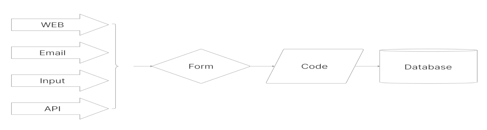
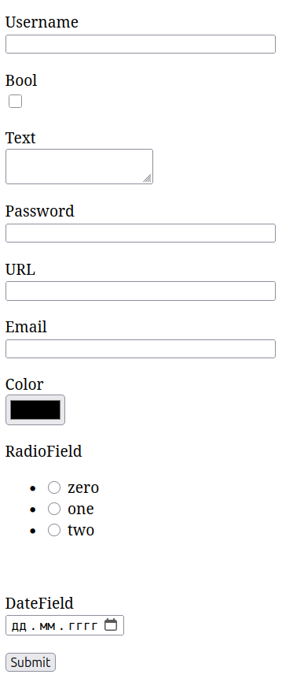

# Обработка HTML форм во Flask

Flask предоставляет простые и гибкие инструменты для обработки HTML-форм, позволяя вам собирать данные от пользователей и обрабатывать их на сервере.

## 1. Создание HTML формы:

Формы создаются с помощью стандартных HTML-тегов `<form>`, `<input>`, `<textarea>`, `<select>` и т.д. Важно указать атрибут `method` (обычно GET или POST) и `action` (URL-адрес обработчика формы).

**Пример HTML-формы:**


```html
<form method="POST" action="/">
  <label for="username">Имя пользователя:</label>
  <input type="text" id="username" name="username" required><br><br>

  <label for="email">Email:</label>
  <input type="email" id="email" name="email" required><br><br>

  <input type="submit" value="Отправить">
</form>
```


## 2. Обработка формы в Flask:

В Flask обработка форм происходит в функции представления (view function), которая обрабатывает HTTP-запрос.

**Пример кода Flask:**


```python
from flask import Flask, render_template, request

app = Flask(__name__)

@app.route('/', methods=['GET', 'POST'])
def index():
  if request.method == 'POST':
    username = request.form['username']
    email = request.form['email']

    # Обработка данных формы (например, сохранение в базе данных)
    print(f"Имя пользователя: {username}, Email: {email}")

    return "Данные успешно отправлены!"
  else:
    return render_template('index.html')

if __name__ == '__main__':
  app.run(debug=True)
```


**Пояснения:**

- `request.method` проверяет, какой HTTP-метод был использован для запроса (GET или POST).
- `request.form` содержит данные, отправленные в форме.
- В данном примере мы извлекаем значения полей `username` и `email` из `request.form`.
- После обработки данных можно вернуть пользователю сообщение об успехе или перенаправить на другую страницу.

## 3. Валидация данных:

Перед обработкой данных важно проверить их корректность. Flask не предоставляет встроенных инструментов валидации, но вы можете использовать сторонние библиотеки, такие как Flask-WTF или WTForms.

**Пример валидации с Flask-WTF:**


```python
from flask_wtf import FlaskForm
from wtforms import StringField, EmailField
from wtforms.validators import DataRequired

class MyForm(FlaskForm):
  username = StringField('Имя пользователя', validators=[DataRequired()])
  email = EmailField('Email', validators=[DataRequired()])
```


## 4. Файлы:

Если форма содержит загрузку файлов, используйте `request.files` для доступа к файлам:


```python
if 'file' in request.files:
  file = request.files['file']
  if file.filename != '':
    # Обработка файла (например, сохранение на диск)
    file.save(f'uploads/{file.filename}')
```


**Рекомендации:**

- Используйте понятные имена полей в форме и соответствующие типы данных.
- Проверяйте данные формы перед обработкой, чтобы предотвратить ошибки и уязвимости.
- Используйте фреймворки валидации для упрощения процесса проверки данных.
- При загрузке файлов проверяйте тип файла и размер, чтобы избежать проблем с безопасностью.

---

# Как работает простая HTML форма

**app.py**


```python
from flask import Flask, render_template, redirect, url_for, request
import os


app = Flask(__name__)


@app.route("/", methods=["GET", "POST"])
def root():
    if request.method == "POST":
        name = request.form.get("name")
        if len(name) > 0:
            return "Форма успешно отправлена!"
    return render_template("form.html")


if __name__ == "__main__":
    app.run(debug=True)
```


**templates/form.html**


```html
<!DOCTYPE html>
<html lang="ru">
<head>
    <meta charset="UTF-8">
    <meta name="viewport" content="width=device-width, initial-scale=1.0">
    <title>Проверка работы формы</title>
</head>
    <body>
        <form method="POST" action="">
            Name: <input id="name" name="name" type="text" value="">
            <input id="submit" name="submit" type="submit" value="Submit">
        </form>
    </body>
</html>
```


Для того, чтобы появилась надпись "Форма успешно отправлена", должно выплниться 2 условия:

1. Нужно отправить данные метододом POST
2. Поле name должно быть заполнено

Иными словами, чтобы выполнить какое-то полезное действие нужно убедиться, что данные формы заполнены корректными данными - например: пароль состоит из букв, цифр и символов, username содержит допустимые символы, возраст записан цифрами, а электронная почта выглядит как электронная почта.

Чем больше таких проверок, тем длиннее становится код. Такой код сложно отладить. Сложно найти баги и легко добавить новые. При необходимости проверить эти же данные в другом месте, придётся копировать код, нарушая принцип DRY.

Во многих популярных фреймворках есть понятие Form (не путать с HTML form). С помощью формы программист проверяет (валидирует) данные, полученные от пользователей. Однажды описав какие данные считаются валидными, программист проверяет их только таким, единственным способом. Это защищает код и хранилище данных от недопустимых данных, от пропусков, искажений и т.д.



Кроме того, форма позволяет программисту показать пользователю данные из хранилища и предложить ему отредактировать их.

# Flask-WTF

Flask-WTF — это расширение для Flask, для работы с формами. Расширение упрощает определение форм с использованием классов Python. Каждое поле формы представлено как атрибут класса, что делает структуру формы понятной и простой в управлении. Flask-WTF обеспечивает систему проверки форм. Мы можем определить валидаторы для каждого поля, чтобы гарантировать, что данные соответствуют заданнам критериям.

Flask-WTF включает встроенную поддержку защиты от подделки межсайтовых запросов (CSRF). Он автоматически добавляет токен CSRF в формы, что помогает защищаться от определенных типов веб-атак.

Flask-WTF поддерживает загрузку файлов с помощью определенных типов полей и валидаторов, таких как `FileAllowed` и `FileRequired`.

Рассмотрим пример того, как мы можем использовать Flask-WTF в приложении Flask:

## Установка


```bash
pip install flask-wtf
```


## Изменим код так, чтобы он работал с формой

**app.py**


```python
from flask import Flask, render_template, redirect, url_for, request
import os
from flask_wtf import FlaskForm
from wtforms import StringField, SubmitField
from wtforms.validators import DataRequired


app = Flask(__name__)
app.config["SECRET_KEY"] = os.urandom(256)


class MyForm(FlaskForm):
    name = StringField("Name", validators=[DataRequired()])
    submit = SubmitField("Submit")


@app.route("/", methods=["GET", "POST"])
def root():
    form = MyForm()
    if request.method == "POST":
        if form.validate_on_submit():
            return "Форма успешно отправлена!"
    return render_template("form.html", form=form)


if __name__ == "__main__":
    app.run(debug=True)
```


**templates/form.html**


```html
<!DOCTYPE html>
<html lang="ru">
<head>
    <meta charset="UTF-8">
    <meta name="viewport" content="width=device-width, initial-scale=1.0">
    <title>Проверка работы формы</title>
</head>
<body>
    <form method="POST" action="">
        {{ form.hidden_tag() }}
        <p>
            {{ form.name.label }}<br>
            {{ form.name(size=32) }}<br>
            
            <span style="color: red;">[{{ error }}]</span><br>
            
        </p>
        <p>{{ form.submit() }}</p>
    </form>
</body>
</html>
```


Для того, чтобы появилась надпись "Форма успешно отправлена", должно выплниться 2 условия:

1. Нужно отправить данные метододом POST
2. Форма должна быть валидной Поле name должно быть заполнено

Количество условий не изменилось, но добавилось понятие "валидность" формы. Появилась проверка подлинности с помощью CSRF токена. Поле name не нужно проверять на длину, оно должно быть обязательным. Для рендеринга шаблона передаётся сама форма `render_template("form.html", form=form)`. Таким образом пользователю можно передать пустую форму для заполнения и форму с данными для редактирования.

В HTML шаблоне содержится только информация о полях формы, но нет упоминания о том, как эти поля должны выглядеть.

# Добавим в форму разные поля, чтобы убедиться, что сложность HTML верстки не изменится

Сколько полей в форме, столько будет одинаковых блоков с разницей только в названии поля.

Установим валидатор адресов электронной почты


```bash
pip install email_validator
```


**app.py**


```python
from flask import Flask, render_template, redirect, url_for, request
from flask_wtf import FlaskForm
from wtforms import (
    StringField,
    SubmitField,
    BooleanField,
    TextAreaField,
    PasswordField,
    FileField,
    TelField,
    URLField,
    EmailField,
    ColorField,
    RadioField,
    Flags,
    DateField,
)
from wtforms.validators import DataRequired, Email, Length, NumberRange, ValidationError, EqualTo
import string
import os


app = Flask(__name__)
app.config["SECRET_KEY"] = os.urandom(256)


choices = [
    (0, "zero"),
    (1, "one"),
    (2, "two"),
]


class DemoForm(FlaskForm):
    def validator_url(self, field):
        url = field.data
        if "vk.com" in url or "ok.ru" in url:
            return
        raise ValidationError('URL должен содержать ссылки на ВК или ОК.')

    def validator_username(self, field):
        username = field.data
        if set(username) <= set(string.ascii_lowercase + string.digits + "_"):
            return
        raise ValidationError('Имя пользователя должно содержать только латинские буквы, цифры и подчеркивание.')

    username = StringField("Username", validators=[DataRequired(), validator_username])
    is_correct = BooleanField("Bool", validators=[DataRequired()])
    text = TextAreaField("Text", validators=[DataRequired()])
    password = PasswordField("Password", validators=[DataRequired()])
    url = URLField("URL", validators=[DataRequired(), validator_url])
    email = EmailField("Email", validators=[DataRequired(), Email()])
    color = ColorField("Color", validators=[DataRequired()])
    radio = RadioField("RadioField", validators=[DataRequired()], choices=choices)
    date = DateField("DateField", validators=[DataRequired()])
    submit = SubmitField("Submit")


@app.route("/", methods=["GET", "POST"])
def root():
    form = DemoForm()
    if request.method == "POST" and form.validate_on_submit():
        return "Форма успешно отправлена!"
    else:
        print(form.errors)
    return render_template("form.html", form=form)


if __name__ == "__main__":
    app.run(debug=True)
```


**templates/form.html**


```html
<!DOCTYPE html>
<html lang="ru">
<head>
    <meta charset="UTF-8">
    <meta name="viewport" content="width=device-width, initial-scale=1.0">
    <title>Демонстрация полей формы</title>
</head>
<body>
    <form method="POST" action="">
        {{ form.hidden_tag() }}
        <p>
            {{ form.username.label }}<br>
            {{ form.username(size=32) }}<br>
            
            <span style="color: red;">[{{ error }}]</span><br>
            
        </p>
        <p>
            {{ form.is_correct.label }}<br>
            {{ form.is_correct(size=32) }}<br>
            
            <span style="color: red;">[{{ error }}]</span><br>
            
        </p>
        <p>
            {{ form.text.label }}<br>
            {{ form.text(size=32) }}<br>
            
            <span style="color: red;">[{{ error }}]</span><br>
            
        </p>
        <p>
            {{ form.password.label }}<br>
            {{ form.password(size=32) }}<br>
            
            <span style="color: red;">[{{ error }}]</span><br>
            
        </p>
        <p>
            {{ form.url.label }}<br>
            {{ form.url(size=32) }}<br>
            
            <span style="color: red;">[{{ error }}]</span><br>
            
        </p>
        <p>
            {{ form.email.label }}<br>
            {{ form.email(size=32) }}<br>
            
            <span style="color: red;">[{{ error }}]</span><br>
            
        </p>         
        <p>
            {{ form.color.label }}<br>
            {{ form.color(size=32) }}<br>
            
            <span style="color: red;">[{{ error }}]</span><br>
            
        </p>         
        <p>
            {{ form.radio.label }}<br>
            {{ form.radio(size=32) }}<br>
            
            <span style="color: red;">[{{ error }}]</span><br>
            
        </p>     
        <p>
            {{ form.date.label }}<br>
            {{ form.date(size=32) }}<br>
            
            <span style="color: red;">[{{ error }}]</span><br>
            
        </p>                          
        <p>{{ form.submit() }}</p>
    </form>
</body>
</html>
```


Обратите внимание блоки кода отличаются только названием поля формы. Их можно расположить как угодно, например в таблице или в бутстрап-карточках.



Если открыть исходный код страницы то увидим следующую картину:


```html
    <form method="POST" action="">
        <input id="csrf_token" name="csrf_token" type="hidden" value="">
        <p>
            <label for="username">Username</label><br>
            <input id="username" name="username" required size="32" type="text" value=""><br>
            
        </p>
        <p>
            <label for="is_correct">Bool</label><br>
            <input id="is_correct" name="is_correct" required size="32" type="checkbox" value="y"><br>
            
        </p>
        <p>
            <label for="text">Text</label><br>
            <textarea id="text" name="text" required size="32"></textarea><br>
        </p>
        <p>
            <label for="password">Password</label><br>
            <input id="password" name="password" required size="32" type="password" value=""><br>
        </p>
        <p>
            <label for="url">URL</label><br>
            <input id="url" name="url" required size="32" type="url" value=""><br>
        </p>
        <p>
            <label for="email">Email</label><br>
            <input id="email" name="email" required size="32" type="email" value=""><br>
        </p>         
        <p>
            <label for="color">Color</label><br>
            <input id="color" name="color" size="32" type="color" value=""><br>
        </p>         
        <p>
            <label for="radio">RadioField</label><br>
            <ul id="radio" size="32"><li><input id="radio-0" name="radio" required type="radio" value="0"> <label for="radio-0">zero</label></li><li><input id="radio-1" name="radio" required type="radio" value="1"> <label for="radio-1">one</label></li><li><input id="radio-2" name="radio" required type="radio" value="2"> <label for="radio-2">two</label></li></ul><br>
        </p>     
        <p>
            <label for="date">DateField</label><br>
            <input id="date" name="date" required size="32" type="date" value=""><br>
        </p>                          
        <p><input id="submit" name="submit" type="submit" value="Submit"></p>
    </form>
```


При рендеринге шаблона вместо переменных с названием поля формы появилось свое поле ввода. Для каждого типа разное. Какое поле ввода появится вместо поля формы зависит от виджета поля формы.

# Рассмотрим два метода класса DemoForm() из Flask-приложения app.py


```python
import string


def validator_url(field):
    url = field.data
    if "vk.com" in url or "ok.ru" in url:
        return
    return False


def validator_username(field):
    username = field.data
    if set(username) <= set(string.ascii_lowercase + string.digits + "_"):
        return
    return False
```


Это очень простые функции, возвращают False или True в зависимости от содержимого строк. Строки - это данные, которые пользователь ввел в форму. Результат работы функции - проверка на правильность этих строк. В целом - это валидаторы формы.

- `validator_url()` убеждается, что в url, который ввел пользователь есть адреса социальных сетей ВКонтакте или Одноклассники. Если помните, вначале курса такой проверки пользовательского ввода очень сильно не хватало.
- `validator_username()` убеждается, что username пользователя состоит только из букв латинского алфавита в нижнем регистре, цифр и символа подчеркивания. При необходимости можно проверить, чтобы username начинался на букву и других таких пользователей в системе нет.

## Как использовать свой валидатор в классе формы


```python
from flask_wtf import FlaskForm
from wtforms import StringField, URLField, EmailField, SubmitField
from wtforms.validators import DataRequired, Email, ValidationError
import string


class DemoForm(FlaskForm):
    def validator_url(self, field):
        url = field.data
        if "vk.com" in url or "ok.ru" in url:
            return
        raise ValidationError('URL должен содержать ссылки на ВК или ОК.')

    def validator_username(self, field):
        username = field.data
        if set(username) <= set(string.ascii_lowercase + string.digits + "_"):
            return
        raise ValidationError('Имя пользователя должно содержать только латинские буквы, цифры и подчеркивание.')

    username = StringField("Username", validators=[DataRequired(), validator_username])
    url = URLField("URL", validators=[DataRequired(), validator_url])
    email = EmailField("Email", validators=[DataRequired(), Email()])
    submit = SubmitField("Submit")
```


Обратите внимание на параметры `validators` каждого из полей:

- `DataRequired()` - все поля этой формы обязательные для ввода.
- `Email()` - для проверки адреса электронной почты на валидность, используется заранее установленный модуль.
- `validator_url` - для проверки url.
- `validator_username` - для проверки username.

`validator_url` и `validator_username` указаны без скобок. Почему?

## Некоторые встроенные валидаторы


```python
Length(min=4, max=25, message="Строка должна быть длиной от 4 до 25 символов.")

NumberRange(min=18, max=120, message="Значение должно быть в диапазоне от 18 до 120.")

EqualTo("password", message="Пароли должны совпадать.")  # сравнивается со значением поля password

Email(message="Введите адрес электронной почты")
```


Здесь `message` - это сообщение, которое увидит пользователь, если валидатор не пропустит значение.

# Проект обрастает кодом и пришла пора вынести класс в отдельный файл

```
my_app/
├── app.py
├── form.py
└── templates/
    └── form.html
```

**app.py**


```python
from flask import Flask, render_template, redirect, url_for, request
from form import DemoForm
import os


app = Flask(__name__)
app.config["SECRET_KEY"] = os.urandom(256)


@app.route("/", methods=["GET", "POST"])
def root():
    form = DemoForm()
    if request.method == "POST" and form.validate_on_submit():
        return "Форма успешно отправлена!"
    else:
        print(form.errors)
    return render_template("form.html", form=form)


if __name__ == "__main__":
    app.run(debug=True)
```


**form.py**


```python
from flask_wtf import FlaskForm
from wtforms import StringField, URLField, EmailField, SubmitField
from wtforms.validators import DataRequired, Email, Length, NumberRange, ValidationError, EqualTo
import string


class DemoForm(FlaskForm):
    def validator_url(self, field):
        url = field.data
        if "vk.com" in url or "ok.ru" in url:
            return
        raise ValidationError('URL должен содержать ссылки на ВК или ОК.')

    def validator_username(self, field):
        username = field.data
        if set(username) <= set(string.ascii_lowercase + string.digits + "_"):
            return
        raise ValidationError('Имя пользователя должно содержать только латинские буквы, цифры и подчеркивание.')

    username = StringField("Username", validators=[DataRequired(), validator_username])
    url = URLField("URL", validators=[DataRequired(), validator_url])
    email = EmailField("Email", validators=[DataRequired(), Email()])
    submit = SubmitField("Submit")
```


**templates/form.html**


```html
<!DOCTYPE html>
<html lang="ru">
<head>
    <meta charset="UTF-8">
    <meta name="viewport" content="width=device-width, initial-scale=1.0">
    <title>Демонстрация полей формы</title>
</head>
<body>
    <form method="POST" action="">
        {{ form.hidden_tag() }}
        <p>
            {{ form.username.label }}<br>
            {{ form.username(size=32) }}<br>
            
            <span style="color: red;">[{{ error }}]</span><br>
            
        </p>
        <p>
            {{ form.is_correct.label }}<br>
            {{ form.is_correct(size=32) }}<br>
            
            <span style="color: red;">[{{ error }}]</span><br>
            
        </p>
        <p>
            {{ form.text.label }}<br>
            {{ form.text(size=32) }}<br>
            
            <span style="color: red;">[{{ error }}]</span><br>
            
        </p>
        <p>
            {{ form.password.label }}<br>
            {{ form.password(size=32) }}<br>
            
            <span style="color: red;">[{{ error }}]</span><br>
            
        </p>
        <p>
            {{ form.url.label }}<br>
            {{ form.url(size=32) }}<br>
            
            <span style="color: red;">[{{ error }}]</span><br>
            
        </p>
        <p>
            {{ form.email.label }}<br>
            {{ form.email(size=32) }}<br>
            
            <span style="color: red;">[{{ error }}]</span><br>
            
        </p>         
        <p>
            {{ form.color.label }}<br>
            {{ form.color(size=32) }}<br>
            
            <span style="color: red;">[{{ error }}]</span><br>
            
        </p>         
        <p>
            {{ form.radio.label }}<br>
            {{ form.radio(size=32) }}<br>
            
            <span style="color: red;">[{{ error }}]</span><br>
            
        </p>     
        <p>
            {{ form.date.label }}<br>
            {{ form.date(size=32) }}<br>
            
            <span style="color: red;">[{{ error }}]</span><br>
            
        </p>                          
        <p>{{ form.submit() }}</p>
    </form>
</body>
</html>
```


# Регистрация пользователя

```
my_app/
├── app.py
├── forms.py
├── utils.py
└── templates/
    └── register.html
```

Усложним наше приложение. Добавим файл c утилитами - полезными функциями.

**utils.py**


```python
import os
import json


def load_json(folder_name, file_name):
    if not os.path.exists(folder_name):
        os.mkdir(folder_name)
    filename = os.path.join(folder_name, file_name)
    if not os.path.exists(filename):
        with open(filename, "w") as f:
            json.dump(dict(), f, ensure_ascii=True)
    with open(filename, encoding="utf-8") as f:
        load_dct = json.load(f)
    return load_dct


def save_json(folder_name, file_name, save_dct):
    if not os.path.exists(folder_name):
        os.mkdir(folder_name)
    filename = os.path.join(folder_name, file_name)
    with open(filename, "w") as f:
        json.dump(save_dct, f, ensure_ascii=False, indent=4)
```


**forms.py**


```python
import string
from flask_wtf import FlaskForm
from wtforms import StringField, PasswordField, SubmitField
from wtforms.validators import DataRequired, Length, ValidationError, EqualTo
from utils import load_json, save_json


class RegistrationForm(FlaskForm):

    def validate_password(self, field):
        password = field.data
        if len(password) < 8:
            raise ValidationError("Пароль должен быть длиной не менее 8 символов.")
        if not len(set(string.digits) & set(password)):
            raise ValidationError("Пароль должен содержать цифры.")
        if not len(set(string.ascii_lowercase) & set(password)):
            raise ValidationError("Пароль должен содержать маленькие латинские буквы.")
        if not len(set(string.ascii_uppercase) & set(password)):
            raise ValidationError("Пароль должен содержать большие латинские буквы.")
        if not len(set(string.punctuation) & set(password)):
            raise ValidationError("Пароль должен содержать символы.")

    def validate_username(self, field):
        username = field.data
        user_dct = load_json("data", "user.json")
        for user in user_dct.values():
            if username == user.get('username'):
                raise ValidationError("Такой пользоваетель уже зарегистрирован.")
        if username in ["admin", "root", "superuser", "director", "chief", "boss"]:
            raise ValidationError("Такое имя пользоваетеля запрещено.")
        if not (set(username) <= set(string.ascii_lowercase + string.digits + "_")):
            raise ValidationError("Имя пользователя должно содержать латинские буквы, цифры и подчеркивание.")

    username = StringField("Имя пользователя", 
        validators=[
            DataRequired(), 
            Length(min=4, max=25, message="Имя пользователя должно быть длиной от 4 до 25 символов."), 
            validate_username
            ])
    password = PasswordField("Пароль", 
        validators=[
            DataRequired(), 
            validate_password
            ])
    confirm = PasswordField("Повтор пароля",
        validators=[
            DataRequired(), 
            EqualTo("password", message="Пароли должны совпадать.")
            ])
    submit = SubmitField("Регистрация")
```


Файл содержит пока одну форму, но очень насыщенный

**app.py**


```python
from flask import (
    Flask,
    render_template,
    redirect,
    url_for,
    request,
)
from forms import RegistrationForm
import os

from utils import load_json, save_json


app = Flask(__name__)
app.config["SECRET_KEY"] = os.urandom(256)


@app.route("/", methods=["GET", "POST"])
def register():
    form = RegistrationForm()
    user_dct = load_json("data", "user.json")
    if request.method == "POST" and form.validate_on_submit():
        new_user = {
            "username": form.username.data,
            "password": form.password.data,
            "confirm": form.confirm.data,
        }
        ids = str(len(user_dct) + 1)
        user_dct[ids] = new_user
        # Запишем не таясь пароль в открытом виде. Чисто в учебных целях
        save_json("data", "user.json", user_dct)
        return "Пользователь зарегистрирован!"
    else:
        print(form.errors)
    return render_template("register.html", form=form)


if __name__ == "__main__":
    app.run(debug=True)
```


Обратите внимание, что в `app.py` нет проверки на состав пароля, имя пользователя и т.д. - все проверяется формой.

**templates/register.html**


```html
<!DOCTYPE html>
<html lang="ru">
<head>
    <meta charset="UTF-8">
    <meta name="viewport" content="width=device-width, initial-scale=1.0">
    <title>Регистрация пользователя</title>
</head>
<body>
    <h1>Регистрация пользователя</h1>
    <form method="POST">
        {{ form.hidden_tag() }}
        <p>
            {{ form.username.label }}<br>
            {{ form.username(size=32) }}
            
                <span style="color: red;">[{{ error }}]</span>
            
        </p>
        <p>
            {{ form.password.label }}<br>
            {{ form.password(size=32) }}
            
                <span style="color: red;">[{{ error }}]</span>
            
        </p>
        <p>
            {{ form.confirm.label }}<br>
            {{ form.confirm(size=32) }}
            
                <span style="color: red;">[{{ error }}]</span>
            
        </p>
        <p>{{ form.submit() }}</p>
    </form>
</body>
</html>
```


Данные пользователей сохраним в JSON файл в папке `data`. Ключ - это целое число, зависящее от количества записей в словаре. В реальной БД будем называть его ID. Значение он имеет такое же - порядковый номер записи.

**data/user.json**


```json
{
    "1": {
        "username": "user1",
        "password": "sIYTLSqhaorDeyPHS2o4!",
        "confirm": "sIYTLSqhaorDeyPHS2o4!"
    }
}
```

