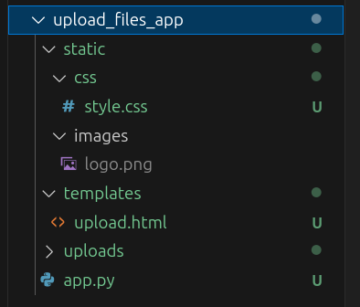

# Статические файлы во Flask

В Flask, статические файлы – это файлы, такие как HTML, CSS, JavaScript, изображения и другие ресурсы, которые не генерируются динамически приложением, а просто подаются пользователю.

## Как Flask обрабатывает статические файлы:

Flask предоставляет специальную папку `static`, которая по умолчанию находится в корневой директории вашего приложения. Внутри этой папки вы можете хранить все ваши статические файлы.


**Пример структуры проекта:**




## Как Flask находит статические файлы:

Когда пользователь запрашивает статический файл, Flask автоматически ищет его в папке `static`. Например, если пользователь запрашивает `/static/css/style.css`, Flask найдет этот файл в `my_app/static/css/style.css` и отправит его пользователю.

## Как ссылаться на статические файлы в шаблонах:

В шаблонах Jinja2 вы можете ссылаться на статические файлы с помощью функции `url_for()`:

```html
<!DOCTYPE html>
<html>
<head>
    <title>Загрузка файла</title>
    <link rel="stylesheet" href="{{ url_for('static', filename='css/style.css') }}">
</head>
<body>
    <h1>Hello, Flask!</h1>
    
</body>
</html>
```

**Функция `url_for('static', filename='css/style.css')`:**

- `static`: указывает Flask, что нужно искать файл в папке `static`.
- `filename`: указывает путь к файлу внутри папки `static` (относительно корня `static`).

## Настройка пути к статическим файлам:

По умолчанию Flask использует папку `static`, но вы можете изменить это поведение, используя параметр `static_folder` при создании приложения или объекта Flask. Но мы оставим все как есть.

```python
from flask import Flask

app = Flask(__name__, static_folder='my_static')
```

## Преимущества использования статических файлов:

- **Простота**: Легко хранить и обслуживать файлы.
- **Производительность**: Статические файлы могут быть кэшированы браузером, что уменьшает нагрузку на сервер.
- **Разделение задач**: Разделяет логику приложения и представление.

## upload.html

```html
<!DOCTYPE html>
<html>
<head>
    <title>Загрузка файла</title>
    <link rel="stylesheet" href="{{ url_for('static', filename='css/style.css') }}">
</head>
<body>

    
        
            
                
                    <div class="error_message">{{ message }}</div>
                
                    <div class="success_message">{{ message }}</div>
                
                    <div class="info_message">{{ message }}</div>
                
                    <div>{{ message }}</div>
                
            
        
    

    <h1>Загрузите файл</h1>
    <form method="POST" enctype="multipart/form-data">
        <input type="file" name="file">
        <button type="submit">Upload</button>
    </form>
</body>
</html>
```

## style.css

```css
.error_message {
    background-color: red;
}

.success_message {
    background-color: green;
}

.info_message {
    background-color: cyan;
}
```


# Статический контент в Flask

Статический контент – это файлы, которые не генерируются динамически приложением Flask, а просто подаются пользователю "как есть". К ним относятся HTML, CSS, JavaScript, изображения, шрифты и другие файлы.

## Хранение статического контента:

По умолчанию Flask ищет статические файлы в папке `static` внутри папки вашего приложения.

**Пример структуры проекта:**

```
my_app/
├── app.py
├── templates/
│   └── index.html
└── static/
    ├── css/
    │   └── style.css
    ├── js/
    │   └── script.js
    └── images/
        └── logo.png
```

## Подача статического контента:

Flask автоматически обрабатывает запросы к файлам в папке `static`.

**Пример:**

Если пользователь запросит `/static/css/style.css`, Flask найдет этот файл в папке `static/css/` и отправит его пользователю.

## Настройка URL-префикса:

Вы можете изменить URL-префикс для доступа к статическим файлам, используя параметр `static_url_path` при создании приложения:

```python
from flask import Flask

app = Flask(__name__, static_url_path='/assets')

# ... остальной код ...
```

Теперь статические файлы будут доступны по адресу `/assets/css/style.css`.

## Использование статических файлов в шаблонах:

Вы можете использовать статические файлы в шаблонах Jinja2, используя тег `url_for()`:

```html
<!DOCTYPE html>
<html>
<head>
    <title>Моя страница</title>
    <link rel="stylesheet" href="{{ url_for('static', filename='css/style.css') }}">
</head>
<body>
    <h1>Привет, мир!</h1>
    
</body>
</html>
```

В этом примере, `url_for('static', filename='css/style.css')` генерирует URL для файла `style.css` в папке `static/css/`.

## Преимущества использования статического контента:

- **Повышение производительности**: Статические файлы обслуживаются веб-сервером напрямую, без обработки приложением Flask, что ускоряет загрузку страницы.
- **Упрощение разработки**: Разделение кода и данных на статический и динамический контент упрощает структуру приложения.
- **Легкость обслуживания**: Статические файлы можно легко обновлять и изменять без необходимости перезапуска приложения.

## Рекомендации:

- Храните статические файлы в отдельной папке `static/`.
- Используйте `url_for()` для доступа к статическим файлам в шаблонах.
- Оптимизируйте статические файлы (сжатие, кеширование) для повышения производительности.

В качестве альтернативы, загруженные файлы можно сохранять в директорию за пределами папки `static`, а затем добавить новый маршрут для их обслуживания. В примере файла приложения `app.py` загруженные файлы сохраняются в местоположении, заданном в переменной конфигурации `UPLOAD_PATH`. Чтобы обслуживать эти файлы из этого местоположения, мы можем обработать следующий маршрут:

```python
from flask import send_from_directory

@app.route("/uploads/<path:filename>")
def uploads_folder(filename):
    return send_from_directory(app.config['UPLOAD_FOLDER'], filename)
```