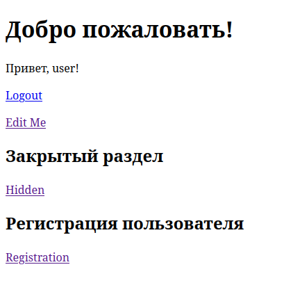

# Аутентификация пользователя

Аутентификация пользователя — это процесс проверки личности пользователя. В контексте веб-приложений это обычно означает проверку того, что пользователь является тем, за кого себя выдает, на основе предоставленных им учетных данных. Аутентификация является одним из основных элементов обеспечения безопасности в веб-приложениях.

## Пример аутентификации пользователя в Flask

Давайте рассмотрим пример простого Flask-приложения, которое использует Flask-Login для аутентификации пользователей. В этом примере пользователи будут аутентифицироваться с использованием имени пользователя и пароля, и после успешной аутентификации они смогут получить доступ к защищенным маршрутам.



Посмотреть исходный код: [flask781](https://github.com/pascal65536/praxis_tmp/tree/main/theory/flask781)

## Установка

```bash
pip install Flask Flask-Login Flask-WTF
```

**Что тут происходит:**

- **Flask-Login**: Управление состоянием аутентификации пользователя. Flask-Login предоставляет удобные декораторы и функции для работы с аутентификацией.
- **UserMixin**: Класс User, который наследуется от UserMixin. Этот класс предоставляет базовые методы, необходимые для работы с Flask-Login.
- **LoginManager**: Мы инициализируем LoginManager и регистрируем функцию load_user, которая загружает пользователя по его идентификатору.
- **login.html**: Форма для ввода имени пользователя и пароля. Также отображает сообщения об ошибках.

**Роуты:**

- `/index`: Маршрут на главную страницу
- `/login`: Маршрут для входа в систему. Если форма валидна, мы проверяем учетные данные пользователя и, если они верны, вызываем `login_user(user)`, чтобы аутентифицировать пользователя.
- `/hidden`: Защищенный маршрут, доступный только аутентифицированным пользователям. Используется декоратор `@login_required`, для того, чтобы запретить доступ неаутентифицированным пользователям.
- `/logout`: Маршрут для выхода из системы. `logout_user()`, чтобы разлогинить пользователя.

Можно скрыть часть html-кода, в зависимости от того, авторизован пользователь, или нет. Например, нет смысла показывать пользователю кнопку Logout, если ещё не был произведён Login.

В закрытый раздел может попасть любой - есть ссылка. Но прочитать содержимое мешает декоратор `@login_required`.

# Шифрование пароля

```bash
pip install flask flask_sqlalchemy flask_login werkzeug
```

```python
from werkzeug.security import generate_password_hash, check_password_hash

wery_secret_password = generate_password_hash('123')

if check_password_hash(wery_secret_password, '123'):
    print('Done!')
```

[Источник](https://www.geeksforgeeks.org/how-to-add-authentication-to-your-app-with-flask-login/)
