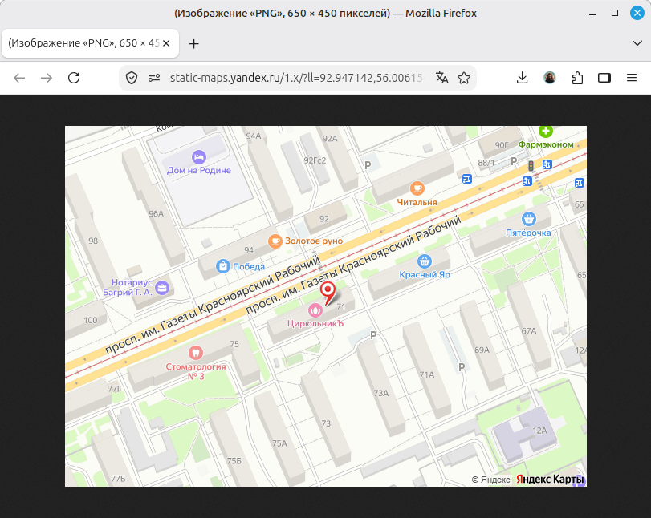

# Yandex map

## Браузер

```
https://static-maps.yandex.ru/1.x/?ll=92.947142,56.006154&z=17&l=map&size=650,450&pt=92.947142,56.006154,pm2rdm
```

[тык](https://static-maps.yandex.ru/1.x/?ll=92.947142,56.006154&z=17&l=map&size=650,450&pt=92.947142,56.006154,pm2rdm)




## CURl

```
curl "https://static-maps.yandex.ru/1.x/?ll=92.947142,56.006154&z=17&l=map&size=650,450&pt=92.947142,56.006154,pm2rdm" -o yandex_map.png
```

## Python + requests

```Python
import requests

url = "https://static-maps.yandex.ru/1.x/"

# Параметры запроса лучше выносить в словарь – так код чище и читаемее
params = {
    "ll": "92.947142,56.006154",
    "z": "17",
    "l": "map",
    "size": "650,450",
    "pt": "92.947142,56.006154,pm2rdm"
}

# Делаем GET-запрос. requests сам соберет URL с параметрами
response = requests.get(url, params=params)

# Проверяем, что запрос прошел успешно (статус 200)
if response.status_code == 200:
    # Открываем файл в режиме 'wb' (write binary - запись бинарных данных)
    with open("yandex_map.png", "wb") as file:
        file.write(response.content)  # response.content содержит байты картинки
    print("Карта успешно сохранена как yandex_map.png")
else:
    print(f"Ошибка загрузки. Статус код: {response.status_code}")
    print("Ответ сервера:", response.text)
```

